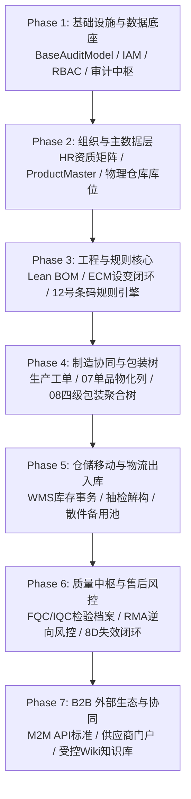

# Bravio ERP 系统构建前架构与数据审计总报告
> **文件位置**：`audit/ERP_SYSTEM_PRE_CONSTRUCTION_AUDIT_REPORT.md`  
> **审计基准**：项目文档库规范文件（文档 00 至 17 + Vibe Coding 规范，共 18 份受控文件）  
> **企业质量合规基准**：ISO 9001:2015、德国联邦机动车运输管理局（KBA）Type Approval & 生产一致性（CoP）  
> **状态**：审阅完成 / 实施指导意见冻结 (Pre-Construction Audit Sealed)

---

## Executive Summary (执行摘要)

本审计报告在全面深入剖析 Bravio ERP 现有 17 份核心业务规范文件后，针对**系统正式进入代码工程构建前**的关键节点开展专项审查。审计团队对整套架构的先进性、严谨性与工业针对性给予高度肯定，系统在 **32位激光微距码物化、Odoo 交互范式、四级包装递归穿透、逆向 RMA 换盒欺诈拦截、APQP 阶段门与不可篡改审计中枢** 方面具备极强的汽车照明工业壁垒。

为确保系统在正式开发与后续长期演进中具备最高的数据库整洁度、可维护性与业务鲁棒性，本报告从以下三个核心维度输出了深度的审计与优化方案：
1. **数据架构与实体整洁度优化**：补全目前文档中隐含引用但未给出物理 DDL 定义的 6 大核心表（工单主表、包装单元表、库存事务流水表、RMA 索赔单表、仓储库位表、标签打印任务表），理顺主外键策略，消除“仓库代码与商业伙伴代码混淆”等建模隐患；
2. **ERP 关键缺失组件补全**：补齐现代工业 ERP 必备的工业级硬件打印服务、多级库位与盘点、单据号发生器、统一告警与待办中枢、多币种与汇率模块；
3. **日常工业与跨国供应链异常场景覆盖**：补全彩盒破损重贴重绑、特采让步放行（Concession）、海关在途集装箱、超产报废销号、实验室留样销毁与供应商质量冻结 6 大高频分支流程。

---

# 第一部分：全局数据资产全景与数据结构优化 (Data Harmonization)

## 1. 核心业务实体全景拓扑 (Domain Entity Map)

整个 Bravio ERP 系统的数据实体可清晰归纳为 **七大领域数据集**，各数据集之间保持单向或受控双向引用关系：

```
┌─────────────────────────────────────────────────────────────────────────────┐
│ 1. 组织安全域 (IAM & Personnel)                                             │
│    sys_users ──┬── hr_employees ──── hr_employee_certifications             │
│    sys_roles ──┘   │                 └── hr_employee_trainings               │
│    audit_trail_logs (全局不可篡改底座)                                      │
└──────────────────────────────────────┬──────────────────────────────────────┘
                                       │
┌──────────────────────────────────────▼──────────────────────────────────────┐
│ 2. 产品与工程工程域 (PLM & BOM Core)                                        │
│    product_masters ──┬── bom_versions ── bom_items                          │
│                      ├── gate_deliverables (APQP 阶段门证据)                │
│                      ├── engineering_changes (ECR/ECO/ECN) ── ec_evidence    │
│                      └── barcode_rule_templates                             │
└──────────────────────────────────────┬──────────────────────────────────────┘
                                       │
┌──────────────────────────────────────▼──────────────────────────────────────┐
│ 3. 供应链协作与商业伙伴域 (Partners & Orders)                               │
│    partners ──┬── partner_addresses                                         │
│               ├── partner_contacts                                          │
│               ├── partner_api_credentials (B2B M2M)                         │
│               └── production_orders (【缺失补全】生产工单主表)               │
└──────────────────────────────────────┬──────────────────────────────────────┘
                                       │
┌──────────────────────────────────────▼──────────────────────────────────────┐
│ 4. 工业溯源与多级包装树域 (Traceability & WMS Core)                         │
│    packaging_units (【缺失补全】BOX/CTN/PLT 四级聚合树)                     │
│         │                                                                   │
│         └── product_items (32位单品激光码物化表、双灯配对、孪生指针)        │
└──────────────────────────────────────┬──────────────────────────────────────┘
                                       │
┌──────────────────────────────────────▼──────────────────────────────────────┐
│ 5. 仓储物流与物理库位域 (Locations & Inventory)                             │
│    warehouses ── stock_locations (【优化重构】物理仓储库位体系)             │
│    inventory_transactions (【缺失补全】WMS 批次/单品异动流水)               │
└──────────────────────────────────────┬──────────────────────────────────────┘
                                       │
┌──────────────────────────────────────▼──────────────────────────────────────┐
│ 6. 质量检验与售后风控域 (QMS & RMA Center)                                  │
│    quality_inspection_records (FQC/IQC/IPQC/CoP)                            │
│    rma_claims (【缺失补全】售后 RMA 索赔单)                                 │
│    quality_incidents ──── quality_eight_d_reports (8D 失效闭环)             │
└─────────────────────────────────────────────────────────────────────────────┘
│ 7. 企业成文知识库域 (DMS)                                                   │
│    wiki_documents ──── wiki_document_revisions                               │
└─────────────────────────────────────────────────────────────────────────────┘
```

---

## 2. 规范化补全缺失的核心表物理模型 (Missing Schema Definitions)

在审查现有规范文档时，我们发现以下表在业务流程（如文档 07、08、09、14、16）中被高频引用作为外键或操作目标，但在前序文档中**缺少完整的物理 DDL 结构定义**。必须在建库前固化其字段标准：

### 2.1 生产工单主表 (`production_orders`)
> **来源**：在文档 07 (`REFERENCES production_orders(order_no)`)、14、16 中被强外键引用。

```sql
CREATE TYPE production_order_status_enum AS ENUM (
    'PLANNED',              -- 已排产计划
    'RELEASED_TO_SUPPLIER', -- 已向代工厂下发
    'IN_PRODUCTION',        -- 产线制造中 (已开始打标/组装)
    'FQC_COMPLETED',        -- 出厂终检完成
    'CLOSED',               -- 工单完工结案
    'CANCELLED'             -- 取消废止
);

CREATE TABLE production_orders (
    order_no VARCHAR(32) PRIMARY KEY,                 -- 工单号，例: "PO-2026-1008"
    product_id UUID NOT NULL REFERENCES product_masters(id),
    supplier_id VARCHAR(32) NOT NULL REFERENCES partners(partner_id),
    bom_version_id UUID NOT NULL REFERENCES bom_versions(id),
    
    -- 目标与完工指标
    target_qty INT NOT NULL CHECK (target_qty > 0),
    produced_qty INT NOT NULL DEFAULT 0,
    scrapped_qty INT NOT NULL DEFAULT 0,              -- 产线制造报废损耗数
    
    -- 关键受控批次特征
    batch_yyww CHAR(4) NOT NULL,                      -- 强制锁定生产年份周次 (如: 2550)
    hw_revision CHAR(1) NOT NULL,                     -- 锁定图纸硬件版次 (如: A)
    ebom_code CHAR(4) NOT NULL,                       -- 锁定供应商 eBOM 代码 (如: 0013)
    hw_version CHAR(2) NOT NULL,                      -- 电气硬件版本 (如: 02)
    allowed_led_bins VARCHAR(10)[] NOT NULL,          -- 本工单允许投入的 LED Binning 列表
    
    -- 状态与时间线
    status production_order_status_enum DEFAULT 'PLANNED',
    planned_start_date DATE NOT NULL,
    planned_end_date DATE NOT NULL,
    actual_completed_at TIMESTAMPTZ,
    
    -- 审计信息
    created_at TIMESTAMPTZ DEFAULT CURRENT_TIMESTAMP,
    created_by_id UUID,
    updated_at TIMESTAMPTZ DEFAULT CURRENT_TIMESTAMP,
    is_deleted BOOLEAN DEFAULT FALSE,
    version_id INT DEFAULT 1
);

CREATE INDEX idx_po_supplier ON production_orders(supplier_id);
CREATE INDEX idx_po_product ON production_orders(product_id);
CREATE INDEX idx_po_yyww ON production_orders(batch_yyww);
```

### 2.2 四级包装单元表 (`packaging_units`)
> **来源**：文档 07、08 核心架构，用于承载 BOX、CARTON、PALLET 的父子递归聚合树。

```sql
CREATE TYPE pack_level_enum AS ENUM ('BOX', 'CARTON', 'PALLET');
CREATE TYPE pack_status_enum AS ENUM (
    'INTACT',       -- 完整封包 (子件数量 100% 吻合)
    'PARTIAL',      -- 余箱/非整箱 (抽检或散件发运后)
    'DISBANDED',    -- 已划开解体 (单品已分流/散件化)
    'SCRAPPED'      -- 破损报废
);

CREATE TABLE packaging_units (
    pack_id VARCHAR(40) PRIMARY KEY,                  -- 包装条码 (例: BOX-20261017-0088, CTN-20261017-0012, PLT-20261017-0001)
    pack_level pack_level_enum NOT NULL,              -- 包装层级
    parent_pack_id VARCHAR(40) REFERENCES packaging_units(pack_id), -- 自引用外键 (实现树状递归)
    
    -- 工业容量与核算
    expected_child_count INT NOT NULL,                -- 标称容量 (BOX=2, CTN=20, PLT=24)
    current_child_count INT NOT NULL,                 -- 当前实际存留子件数
    
    -- 配对与溯源信息
    order_no VARCHAR(32) REFERENCES production_orders(order_no),
    paired_led_bin CHAR(5),                           -- 针对 BOX 层级: 死绑定的色温光通量档位 (如: B3W3G)
    pack_status pack_status_enum DEFAULT 'INTACT',
    
    -- 物理仓位归属
    current_warehouse_id VARCHAR(32),                 -- 当前所在物理仓库 (例: DE_CENTRAL_WH)
    current_location_id VARCHAR(50),                  -- 当前物理货架库位 (例: LOC-RECV-01, LAB-RACK-03)
    
    created_at TIMESTAMPTZ DEFAULT CURRENT_TIMESTAMP,
    updated_at TIMESTAMPTZ DEFAULT CURRENT_TIMESTAMP
);

CREATE INDEX idx_pack_parent ON packaging_units(parent_pack_id);
CREATE INDEX idx_pack_level_status ON packaging_units(pack_level, pack_status);
CREATE INDEX idx_pack_order ON packaging_units(order_no);
```

### 2.3 物理仓储与库位体系 (`warehouses` & `stock_locations`)
> **优化重点**：彻底理清文档 07/08 中将 `current_owner_id` 填入 `'DE_CENTRAL_WH'` 的模型混淆。

```sql
-- 物理仓库主表
CREATE TABLE warehouses (
    warehouse_id VARCHAR(32) PRIMARY KEY,             -- 仓库代码，如: "DE_MUC_WH", "CN_DG_FACTORY_WH"
    warehouse_name VARCHAR(100) NOT NULL,             -- 仓库全称 (如: "德国慕尼黑中央保税与质检总仓")
    country_code CHAR(2) NOT NULL DEFAULT 'DE',
    address_text TEXT NOT NULL,
    is_bonded BOOLEAN DEFAULT FALSE,                  -- 是否为保税仓库 (涉及关税清关)
    is_active BOOLEAN DEFAULT TRUE,
    created_at TIMESTAMPTZ DEFAULT CURRENT_TIMESTAMP
);

-- 库位细分表 (支持多级货位精细管理)
CREATE TYPE location_type_enum AS ENUM (
    'RECEIVING',       -- 收货暂存区
    'IQC_HOLDING',     -- 质检待检/锁定区
    'QUALIFIED_STOCK', -- 合格良品上架区 (可直接销售出运)
    'LAB_RETAINED',    -- 慕尼黑实验室法定留样区
    'LOOSE_SPARE',     -- 售后散件备用区
    'DEFECTIVE_QUARANTINE', -- 不良品隔离区
    'SHIPPING_DOCK'    -- 发货集货泊位
);

CREATE TABLE stock_locations (
    location_id VARCHAR(50) PRIMARY KEY,              -- 物理库位编号，例: "DE-MUC-LAB-RACK-03-B2", "DE-MUC-A-01-04"
    warehouse_id VARCHAR(32) NOT NULL REFERENCES warehouses(warehouse_id),
    location_name VARCHAR(100) NOT NULL,
    location_type location_type_enum NOT NULL,
    max_capacity_pallets INT DEFAULT 1,
    is_locked BOOLEAN DEFAULT FALSE,                  -- 盘点锁库标记
    created_at TIMESTAMPTZ DEFAULT CURRENT_TIMESTAMP
);

CREATE INDEX idx_stock_loc_wh_type ON stock_locations(warehouse_id, location_type);
```

### 2.4 WMS 库存与包装移动事务流水表 (`inventory_transactions`)
> **来源**：在文档 08 步骤 5 中提及，但未给出定义。是 ISO 9001 溯源审计的核心凭证。

```sql
CREATE TYPE inv_tx_type_enum AS ENUM (
    'MFG_RECEIPT',          -- 代工厂组装入库
    'EXPORT_OUTBOUND',      -- 供应商干线发货出库
    'IMPORT_INBOUND_LOCKED',-- 德国仓到货暂存 (自动打质检锁定)
    'IQC_DISBAND_SAMPLE',   -- 质检抽检开箱/拆盒留样
    'TRANSFER_TO_SPARE',    -- 孪生件转入售后散件库
    'B2B_SALES_OUTBOUND',   -- B2B 整箱/整盘调拨出库
    'RMA_RECEIPT_RETURN',   -- RMA 逆向退运登记
    'SCRAP_DISPOSAL'        -- 不良品报废出库
);

CREATE TABLE inventory_transactions (
    id UUID PRIMARY KEY DEFAULT gen_random_uuid(),
    tx_no VARCHAR(32) NOT NULL UNIQUE,                -- 事务单号，如: "TX-20261017-0091"
    tx_type inv_tx_type_enum NOT NULL,
    
    -- 涉及的对象 (支持对托盘、外箱、彩盒或单个SN的操作)
    pack_id VARCHAR(40) REFERENCES packaging_units(pack_id),
    sn_code CHAR(32) REFERENCES product_items(sn_code),
    product_id UUID REFERENCES product_masters(id),
    
    -- 物理位置轨迹 (From -> To)
    from_warehouse_id VARCHAR(32) REFERENCES warehouses(warehouse_id),
    from_location_id VARCHAR(50) REFERENCES stock_locations(location_id),
    to_warehouse_id VARCHAR(32) REFERENCES warehouses(warehouse_id),
    to_location_id VARCHAR(50) REFERENCES stock_locations(location_id),
    
    qty INT NOT NULL DEFAULT 1,                       -- 影响数量 (件/支)
    operator_id UUID NOT NULL,                        -- 操作员工 ID
    operator_name VARCHAR(100) NOT NULL,
    associated_doc_no VARCHAR(64),                    -- 关联单据 (如检验单号、发货单号、RMA单号)
    notes TEXT,
    
    occurred_at TIMESTAMPTZ NOT NULL DEFAULT clock_timestamp()
);

CREATE INDEX idx_inv_tx_pack ON inventory_transactions(pack_id);
CREATE INDEX idx_inv_tx_sn ON inventory_transactions(sn_code);
CREATE INDEX idx_inv_tx_type_date ON inventory_transactions(tx_type, occurred_at);
```

### 2.5 售后 RMA 逆向索赔单表 (`rma_claims`)
> **来源**：文档 09 业务逻辑的实体载体。

```sql
CREATE TYPE rma_claim_status_enum AS ENUM (
    'CLAIM_SUBMITTED',     -- 收到售后客诉
    'PHYSICAL_RECEIVED',   -- 实物已收到并完成扫码
    'RISK_AUDIT_PASSED',   -- 逆向风控审核通过 (无欺诈、无跨区串货)
    'RISK_FRAUD_FLAGGED',  -- 触发高危拦截警告 (换盒/串货)
    'REPLACEMENT_SHIPPED', -- 同 Binning 备件已补发
    'LAB_ANALYZING_8D',    -- 移交实验室启动 8D 失效调查
    'CLOSED_RESOLVED',     -- 售后结案
    'REJECTED_RETURN'      -- 驳回退还客户
);

CREATE TABLE rma_claims (
    id UUID PRIMARY KEY DEFAULT gen_random_uuid(),
    claim_no VARCHAR(32) NOT NULL UNIQUE,             -- RMA 单号，例: "RMA-2026-0033"
    customer_id VARCHAR(32) NOT NULL REFERENCES partners(partner_id),
    
    -- 退回实物与比对锚点
    sn_code CHAR(32) NOT NULL REFERENCES product_items(sn_code),
    submitted_box_id VARCHAR(40),                     -- 客户随机附带退回的彩盒码
    
    -- 风控判定标记 (由文档 09 规则引擎自动计算)
    is_box_mismatch_warning BOOLEAN DEFAULT FALSE,   -- 换盒欺诈
    is_cross_region_warning BOOLEAN DEFAULT FALSE,   -- 跨区串货
    is_warranty_expired BOOLEAN DEFAULT FALSE,       -- 是否已超质保期
    
    -- 关联留样与补偿
    matched_retained_sn CHAR(32) REFERENCES product_items(sn_code), -- 同批次留样件
    replacement_sn_code CHAR(32) REFERENCES product_items(sn_code), -- 补发的同Bin散件
    
    fault_symptom_category VARCHAR(50) NOT NULL,      -- 故障类别
    customer_complaint_desc TEXT NOT NULL,
    tech_investigation_note TEXT,
    
    status rma_claim_status_enum DEFAULT 'CLAIM_SUBMITTED',
    handled_by_id UUID,
    created_at TIMESTAMPTZ DEFAULT CURRENT_TIMESTAMP,
    updated_at TIMESTAMPTZ DEFAULT CURRENT_TIMESTAMP,
    is_deleted BOOLEAN DEFAULT FALSE,
    version_id INT DEFAULT 1
);

CREATE INDEX idx_rma_sn ON rma_claims(sn_code);
CREATE INDEX idx_rma_customer ON rma_claims(customer_id);
CREATE INDEX idx_rma_status ON rma_claims(status);
```

---

## 3. 冗余字段识别与结构治理优化方案 (Redundancy & Structural Refinement)

### 3.1 `product_items` 计算列物化与存储性能权衡 (Stored Columns Analysis)
- **现状分析**：文档 07 在 `product_items` 中建立了 10 个 `GENERATED ALWAYS AS (SUBSTRING(...)) STORED` 列。
- **审计结论**：
  - **合理性**：汽车行业在按年份周次（`prod_yyww`）、LED 综合分档（`led_full_bin`）和零件号（`bravio_id`）做高频过滤、聚类统计、配对防呆时，物化存储列能享受 B-Tree 索引的毫秒级扫描，避免每次查询扫描千万级数据做字符串动态截取，**非常适合工业追溯场景**。
  - **优化精简点**：其中 `led_color_bin` (2位)、`led_flux_bin` (2位)、`led_vf_bin` (1位) 均已被 `led_full_bin` (5位，涵盖三者) 完整包含。业务检索（包括配对校验）99% 是针对 `led_full_bin` 整体比对。
  - **建议**：保留 `led_full_bin` 物理物化列及高频业务索引；对三个超微细分字段，可转为虚拟视图（Virtual View）或在需要时直接根据切片取用，减少单表存储宽度与行膨胀（PostgreSQL TOAST / Row Size 优化）。

### 3.2 所有权（Owner）与物理库位（Location）解耦
- **现状分析**：文档 07/08 中 `product_items.current_owner_id` 既用来关联分销商客户（`partners.partner_id`），又在示例中被赋值为 `'DE_CENTRAL_WH'`（仓库）。
- **隐患**：破坏了关系型数据库的**外键语义单一性**。仓库是物理管理主体，合作伙伴是法律实体或商业受票主体。
- **优化方案**：
  - 在 `product_items` 表中显式拆解为两个正交字段：
    - `current_warehouse_id VARCHAR(32) REFERENCES warehouses(warehouse_id)` —— 指向当前物理所在仓库；
    - `current_owner_id VARCHAR(32) REFERENCES partners(partner_id)` —— 指向当前法定所有权人（出厂前为 Bravio，出库后变更为代理商客户）。

### 3.3 统一通用审计基类 (`BaseAuditModel`) 规范
- **现状分析**：部分表（如 `engineering_changes`, `product_masters`）定义了 `version_id`、`is_deleted`，而 `quality_inspection_records`、`wiki_documents` 缺失了软删除或乐观锁字段；主键有的使用 UUID，有的使用业务编码。
- **统一规范建议**：
  1. **代理主键统一**：除 `sn_code`（激光码为天然法定全局唯一 32 位主键）外，所有单据、规则、主数据表一律采用 `UUID DEFAULT gen_random_uuid()` 作为物理主键，业务单号（如 `order_no`, `ec_no`, `inspection_no`）保持 `UNIQUE` 业务索引。这确保了在分布式环境、跨库数据迁移和数据恢复时外键永不冲突。
  2. **统一审计字段群**：所有业务模型强制继承 Base 抽象：
     - `created_at TIMESTAMPTZ DEFAULT CURRENT_TIMESTAMP`
     - `created_by_id UUID`
     - `updated_at TIMESTAMPTZ DEFAULT CURRENT_TIMESTAMP`
     - `updated_by_id UUID`
     - `is_deleted BOOLEAN DEFAULT FALSE`
     - `version_id INT DEFAULT 1`（支持高并发乐观锁防并发覆盖）。

---

# 第二部分：核心业务功能与组件盲区补全 (Missing Components)

在对 17 份文档的业务流闭环审阅中，我们识别出以下 6 项在日常 ERP 运作中必然发生、但文档目前尚未固化模块规范的组件：

## 1. 工业级硬件打印中枢与标签模板引擎 (Industrial Print Hub)
- **痛点**：文档 07、08、12 多次提及“触发工位打印盒贴”、“打印托盘大标签”、“打印慕尼黑实验室留样黄色标签”。但在实际车间中，Web 页面无法直接驱动斑马（Zebra）或台半（TSC）热敏条码打印机进行工业级毫秒级喷码。
- **补全组件设计**：
  - **标签模板数据表 (`label_templates`)**：支持基于 ZPL-II（Zebra Programming Language）指令集与 TSPL 驱动的模板管理。
  - **本地硬件打印服务代理（Print Proxy Agent）**：在包装工位或检测台电脑后台运行轻量级 WebSocket 打印代理，FastAPI 后端在防呆事务提交成功后，直接向本地代理下发 ZPL 渲染字节流，实现零弹窗、零延迟工业盲打。

```sql
CREATE TABLE label_templates (
    id UUID PRIMARY KEY DEFAULT gen_random_uuid(),
    template_code VARCHAR(50) NOT NULL UNIQUE,       -- 如: "TPL_BOX_RETAIL_100X60"
    template_name VARCHAR(100) NOT NULL,
    target_level barcode_target_level_enum NOT NULL, -- SN, BOX, CARTON, PALLET, SAMPLE
    printer_driver_type VARCHAR(20) DEFAULT 'ZPL',   -- 'ZPL', 'TSPL', 'ESC_POS', 'PDF'
    zpl_raw_code TEXT NOT NULL,                      -- 包含动态变量的 ZPL 模板
    dpi INT DEFAULT 300,                             -- 打印机分辨率 (300DPI 适合微距小标)
    is_active BOOLEAN DEFAULT TRUE,
    created_at TIMESTAMPTZ DEFAULT CURRENT_TIMESTAMP
);
```

---

## 2. 仓库多级库位与动态移库/盘点组件 (Stock Location & Cycle Count)
- **痛点**：目前文档仅提到了“留样架号（如 `DE-MUC-LAB-RACK-03-B2`）”，但缺少仓库日常必须的“货位上架（Putaway）”、“库位转移（Location Transfer）”和“周期性盘点（Cycle Count）”模型。
- **补全组件设计**：
  - **移库指令单 (`stock_transfer_orders`)**：支持在系统内将某一托盘或某一箱货物从“收货暂存区（RECEIVING）”上架到“高位立体货架（QUALIFIED_STOCK）”，并联动生成 `inventory_transactions`。
  - **静态/动态盘点任务 (`stock_cycle_counts`)**：支持按货架、按生产周次发起盲盘或明盘，记录盘盈盘亏并输出审批流，确保账实严格相符（符合 ISO 9001 资产与物料受控要求）。

---

## 3. 全局业务单据流水号发生器 (Unified Document Sequence Engine)
- **痛点**：文档中散落着各种编码格式（如 `PO-2026-1008`, `QC-20261017-001`, `INC-2026-0042`, `EC-2026-0008`），文档 12 规范了条码（SN/BOX/CTN/PLT），但缺少非条码类的业务单据号统一生成机制。
- **补全组件设计**：
  - 建立统一的单据号规则表 (`sys_document_sequences`)，支持配置前缀（Prefix）、日期维度（YYYYMM/YYYYMMDD）、流水步长、每日/每月自动归零，通过 Redis 原子自增或 PostgreSQL 序列保障高并发下绝对不产生重号或跳号。

---

## 4. 跨模块预警、待办与多渠道通知中枢 (Unified Alert & Notification Hub)
- **痛点**：
  - 文档 04 要求资质到期前 60 天红黄绿预警；
  - 文档 09 要求周次 RMA 故障率 $\ge 0.5\%$ 时触发 KBA 生产一致性事故严重告警；
  - 文档 14 要求 8D 报告 D3 阶段 24 小时内完成围堵；
  - 文档 13 要求发布 ECN 时向所有代工厂推送强制令。
- **补全组件设计**：
  - 建立轻量级统一通知引擎（`sys_notifications` & `sys_todo_tasks`）。
  - 支持三层分发通道：
    1. **前端实时推送**：基于 WebSocket / Server-Sent Events (SSE)，在顶部导航栏响铃并弹出气泡；
    2. **Chatter 聚合**：自动在相关对象的时间轴内插入高优先级待办卡片；
    3. **外发邮件/Webhook 广播**：针对高危合规事件，向负责人的企业邮箱或代工厂技术接口人发送警报。

---

## 5. 跨国多币种与汇率核算支持 (Multi-Currency & FX Exchange)
- **痛点**：文档 17 中供应商结算支持 CNY/USD/EUR，欧洲客户分销结算支持 EUR。但未定义汇率折算与对账底座。
- **补全组件设计**：
  - 建立每日基准汇率表 (`financial_exchange_rates`)，按欧洲央行（ECB）每日官方挂牌汇率同步。
  - 所有涉及金额的单据（采购工单、售后赔偿、RMA 运费结算）统一记录“原始币种 + 发生时基准汇率 + 欧元本位币折算金额”，为后续对接轻量财务模块打下坚实基础。

---

## 6. 合规数据受控导出与敏感信息脱敏中枢 (Export & Privacy Engine)
- **痛点**：文档 03、05、15 强调防泄密，但实际业务中质保总监经常需要导出包含数万条单品 SN 的 Excel 报表提供给外部审核员。
- **补全组件设计**：
  - 建立异步导出任务队列 (`system_export_tasks`)：大体量报表在 Celery 异步生成，避免阻塞主线程；
  - 自动向导出的 Excel/PDF 嵌入包含当前操作人姓名、工号、IP 与时间戳的**只读加密或不可去除的水印**；
  - 导出记录永久写入不可篡改审计表 `audit_trail_logs`。

---

# 第三部分：日常业务场景与异常分支工作流补全 (Operational Scenarios)

经模拟日常工厂制造、跨国海运与海外仓维保的实际运作，现有文档主要描述了“正常主干流（Happy Path）”，必须补齐以下 6 个**日常必然发生的高频异常分支工作流**：

## 1. 包装异常重贴标与防呆重绑流程 (Re-labeling & Re-boxing Flow)
- **异常场景**：在代工厂包装流水线或德国海外仓，可能发生：
  1. 打印机缺墨或热敏纸卡纸，导致打出的 `BOX_ID` 标签破损模糊；
  2. 质检或搬运中，彩盒外壳被压破，但内部两支车灯单品完好无损；
  3. 扫码枪误扫导致临时挂起。
- **补全的受控解绑与换盒重贴流程**：
  ```mermaid
  sequenceDiagram
      autonumber
      actor Worker as 包装工位组长 (Shift Leader)
      participant UI as 异常重贴控制台
      participant Core as 包装解析引擎
      participant DB as PostgreSQL 16
      
      Worker->>UI: 触发 [异常换盒/重贴] 模式 (需班组长刷卡授权)
      Worker->>UI: 扫描破损的原始彩盒码 (BOX-OLD) 或盒内任一单品 (SN_1)
      Core->>DB: 调取当前彩盒状态，锁定该盒内绑定的两支单品 (SN_1, SN_2)
      Worker->>UI: 确认操作原因: [外盒压损 / 条码模糊]
      Core->>DB: 将 BOX-OLD 状态更新为 'DISBANDED' (已报废作废)，解除绑定
      Core->>Core: 校验 SN_1 与 SN_2 的 Binning 是否仍然一致
      Core->>DB: 生成全新合规彩盒码 (BOX-NEW)，将 SN_1, SN_2 重新死绑定至 BOX-NEW
      Core->>UI: 触发打印机重新喷码输出 BOX-NEW 标签贴纸
      Core->>DB: 记录异常处置审计日志 (记录人、时间、原盒号、新盒号)
  ```
- **核心合规防呆**：
  - 必须记录 `original_box_id` 与变更历史链条，系统禁止随意向已有两个单品的完整彩盒中塞入第三支灯；
  - 换盒重贴必须由具备班组长及以上权限的角色执行，普通工人无权隐蔽换盒。

---

## 2. 特采让步放行与受控降级销售闭环 (Concession / Waiver Flow)
- **异常场景**：在文档 14 中，检验结果定义了 `'CONCESSION_PASS'`（特采让步）。但在汽车工业中，特采绝不能只改一个状态，否则无法向 KBA 交代。
- **补全的特采放行闭环模型**：
  1. **发起特采申请单 (`quality_concessions`)**：记录申请原因（例：外壳压铸件表面轻微划痕，但不影响结构密封与光电指标）、涉及批次周次、申请特采数量上限；
  2. **跨部门会签签署**：必须集齐 **研发工程总监（确认无安全/光学影响） + 质量总监（确认符合法规底线）** 双重数字签名与 TOTP 电子盖章；
  3. **受控流向锁定**：被批准特采的批次，在系统内自动打上 `IS_CONCESSION_BATCH = TRUE`。WMS 出库算法**严禁将其发往高标准整车主机厂（OEM_TIER1）**，仅允许按受控特价折让发给普通售后分销商（B2B_DISTRIBUTOR），并在出库单据上打印特采备注文档编号。

---

## 3. 跨国海关在途报关与集装箱跟踪 (Customs Clearance & Container Tracking)
- **异常场景**：文档 08 中，托盘在制造厂完工后直接跃迁至 `IN_TRANSIT_TO_DE`，再到 `LOCKED_PENDING_IQC`。但在实际跨国海运中，航程长达 30~45 天，中途涉及报关、提单号变更、集装箱柜号锁定与预计到港日（ETA）更新。
- **补全的物流发运单模型 (`shipment_containers`)**：
  - 在工厂发货与德国仓收货之间插入**海运发运单实体**：记录海运提单号（B/L No.）、集装箱柜号（Container No.）、承运船公司、报关发票号（Commercial Invoice）、启运港（POL）与目的港（POD - 汉堡/鹿特丹）。
  - **托盘与集装箱死绑定**：托盘状态变为 `IN_TRANSIT_OCEAN` 时关联至该柜号。若德国海关要求提前预申报舱单（AMS/ISF/ENS），系统一键导出该集装箱内包含的所有 24 个托盘、576 个外箱及 23,040 支车灯的完整合规装箱单明细。

---

## 4. 产线备品损耗、超产报废与 SN 销号流 (Scrap & SN Invalidation Flow)
- **异常场景**：代工厂在安排打标时，通常按工单计划量额外请求 2% 的备品额度（损耗裕量）。但在组装焊接过程中，部分车灯可能在 SMT 贴片打件时烧毁、或在耐压测试时击穿。
- **补全的单品作废销号流程**：
  - 代工厂 MES 通过 API 调取作废接口：`POST /api/v1/b2b/supplier/items/scrap`。
  - 传入已雕刻但报废的 `sn_code` 及报废原因代码（如 `SMT_REFLOW_BURN`, `TEST_HIPOT_FAIL`）。
  - 后端将该单品状态变更为 `SCRAPPED_AT_SUPPLIER`，解除与工单的完工绑定，并释放流水号统计。这从源头上杜绝了代工厂将报废灯的条码私自挪用到其他非受控产品上的隐患。

---

## 5. 慕尼黑实验室留样合规生命周期终结与销毁 (Retained Sample Disposal)
- **异常场景**：德国 KBA 生产一致性法规通常要求留样保存至该批次产品**停产后 2 年至 5 年**。随着周次累加，实验室物理留样架可能被塞满，过期的留样样品需要受控腾退。
- **补全的留样生命周期管理流程**：
  1. **留样年限预警**：系统按 `prod_yyww` 与产品 `lifecycle_status` 自动计算留样保管到期日；
  2. **处置申请与抽样复测**：到期前由质量合规官发起《留样到期销毁处置评审》，确认近 3 年内无该周次的未决客诉与诉讼案件；
  3. **受控物理销毁（Certificate of Destruction）**：由实验室工程师执行物理破坏性砸碎/拆解，拍照上传销毁存证，系统将 `sample_rack_location` 库位清空释放，并将单品状态更新为 `RETAINED_SAMPLE_DESTROYED`。

---

## 6. 合作伙伴信用与质量双重冻结机制 (Partner Quality/Credit Hold)
- **异常场景**：
  1. 某代工厂遭遇突发重大质量事故（如抽检发现焊膏大面积空洞），必须立即叫停其所有工单生产；
  2. 某欧洲分销商严重拖欠货款超过授信期，需阻断其发货。
- **补全的双通道冻结机制**：
  - 在 `partners` 表中增加：
    - `is_quality_hold BOOLEAN DEFAULT FALSE`（质量冻结：系统强制阻断其 API 下单、阻断条码预分配、阻断出厂入库）；
    - `is_financial_hold BOOLEAN DEFAULT FALSE`（财务冻结：销售订单禁止通过审批，仓储禁止为其出运托盘）。
  - 任何冻结与解冻操作均强制要求录入依据单号与双人审核，记录不可篡改审计流水。

---

# 第四部分：实施依赖拓扑与系统构建路线图 (Construction Roadmap)

为了指导后续正式编码与多模型开发，我们为工程实施梳理了严格的**依赖拓扑关系图**。请在后续执行代码生成时严格遵循以下顺序推进：



## 实施阶段详解

| 阶段划分 | 对应规范文档 | 核心输出内容与里程碑验收目标 |
| :--- | :--- | :--- |
| **Phase 1: 系统骨架与安全中枢** | 01, 03, 05 | FastAPI 基础框架、Argon2id 散列、JWT+TOTP 2FA 认证管线、不可篡改审计日志表与中间件。 |
| **Phase 2: 人员组织与产品主数据** | 04, 10, 17 | 部门岗位、资质矩阵与到期预警状态机；产品主数据模型与 APQP 阶段门存证表；仓库与库位模型。 |
| **Phase 3: 规格规则与工程变更** | 11, 12, 13 | BOM 结构化快照与版本排他切换逻辑；多层级占位符条码规则引擎；ECR/ECO/ECN 四大证据包发布与锁定。 |
| **Phase 4: 单品打标与包装聚合** | 07, 08, 16 | 32位激光微距码 PostgreSQL STORED 物化计算列；工位双灯 Binning 防呆状态机；`packaging_units` 四级树。 |
| **Phase 5: WMS 流水与抽检拆解** | 08, 16 | `WITH RECURSIVE` 递归穿透查询引擎；德国仓抽检余箱降级与拆盒单支留样、孪生件转散件算法。 |
| **Phase 6: 质量检验与 RMA 风控** | 09, 14 | FQC/IQC 批次检验对账台账；单支扫码逆向换盒与串货风控矩阵；汽车 8D 结构化调查报告与免整改闭环。 |
| **Phase 7: B2B 对接与受控知识库** | 15, 16, 17 | M2M API Token 鉴权与 IP 白名单网关；外部数据回传接口；DMS 动态半透明防泄密水印引擎。 |

---

# 结论与下一步行动指引 (Next Actions)

依据本次全方位审阅：
1. **当前文档体系评定**：现有 17 份规范文件逻辑自洽、技术选型先进、针对汽车工业合规（ISO 9001 / KBA CoP）的把控极为精准，**完全具备进入正式系统开发的条件**。
2. **本审计报告价值**：通过本报告第一、二、三部分的治理与补充，补全了 6 张核心物理表、填补了 6 项系统关键通用组件，并将 6 个日常必然遭遇的工业异常分支流程进行了标准化固化，彻底消除了未来开发过程中“返工重构数据库”或“业务逻辑卡壳”的风险。
3. **下一步执行建议**：
   - 用户确认本审计报告内容；
   - 确认后即可按照 **Phase 1（基础底座与数据一致性）** 开始进行工程代码脚手架搭建与建库初始化。
