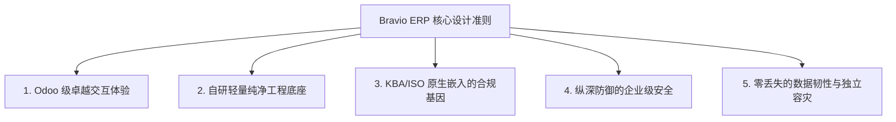

# 00 - 项目总览与企业合规基准 (Project Overview & Regulatory Baseline)

---

## 1. 企业背景与业务定位

**Bravio** 是一家专注高品质制造与全球化供应链的现代化创新企业。
企业具备两项决定系统架构底层标准的关键资质与目标：

1. **已持有 ISO 9001:2015 质量管理体系认证**：
   - 核心关注：以客户为中心、领导作用、全员参与、过程方法、改进、循证决策、关系管理。
   - 对系统的要求：所有核心业务流必须具备**可证实的过程证据**、**受控文件与记录管理**、**纠正与预防措施（CAPA）**追踪能力。
2. **正准备通过德国联邦机动车运输管理局（KBA, Kraftfahrt-Bundesamt）Type Approval（型式认证）**：
   - KBA 是欧盟乃至全球汽车与零部件工业最严谨权威的认证机构之一。
   - 核心审查要点包含：
     - **生产一致性（Conformity of Production, CoP）**：企业必须能够向审核员证明批量生产的产品与送检样品完全一致。
     - **全流程双向追溯性（Bidirectional Traceability）**：从供应商原材料批次、生产线工序、检验测试记录，到最终出货序列号，必须能够双向毫秒级追溯。
     - **工程变更控制（Management of Change, MoC）**：任何技术参数、图纸、软件、物料或工艺变更，必须经过受控审批与评审，杜绝“擅自变更”或“变更未留痕”。
     - **人员任职资格与能力矩阵（Competence Matrix）**：涉及关键安全项（Special Characteristics）的人员必须持有有效资质，资质过期或未经认证者系统需具备预警与阻断机制。

---

## 2. 系统设计核心准则（Core Design Principles）

根据 Bravio 的战略目标，ERP 系统的研发贯彻以下五项不可妥协的设计准则：

### 准则 1：Odoo 级卓越交互体验（UI/UX Reference）
- 借鉴 Odoo 的精髓：**统一控制台（Control Panel）**、**多维智能过滤与分组**、**极简面包屑**、**多视图无缝切换（List/Form/Kanban）**、以及沉淀全部沟通与操作记录的 **Chatter 审计侧边栏**。
- 拒绝粗制滥造的传统“表格堆砌型”管理系统，让员工与审核员拥有流畅现代的操作体验。

### 准则 2：自研轻量纯净工程底座（Independent Architecture）
- **绝不使用 Odoo 原版框架**：彻底规避 Odoo 繁复陈旧的 ORM 机制、高耦合的 XML/QWeb/OWL 体系以及沉重的历史包袱。
- 采用工业界标准的现代分层架构：前后端彻底分离，RESTful / OpenAPI 规范驱动，数据库完全自主建模与调优。

### 准则 3：KBA/ISO 原生嵌入的合规基因（Compliance-by-Design）
- 系统每一张业务主表原生自带：
  - `created_at`、`created_by_id`（创建记录）
  - `updated_at`、`updated_by_id`（最后修改记录）
  - `version_id`（行级乐观锁与版本控制）
  - `is_deleted`、`deleted_at`、`deleted_by_id`（软删除，杜绝合规记录物理丢失）
- 关键表挂载**不可篡改审计流（Immutable Audit Trail）**：自动抓取修改前后字段差异、操作人真实身份、IP 与业务原因。

### 准则 4：纵深防御的企业级安全（Enterprise Security）
- 严格遵循 OWASP Top 10 防护标准。
- 采用 Argon2id 密码散列算法（内存硬抗暴力破解）。
- 细粒度基于角色与属性的访问控制（RBAC + ABAC），并支持组织级多租户/行级隔离。
- 原生支持基于标准时间基准（RFC 6238）的 TOTP 多因子认证（MFA）。

### 准则 5：零丢失的数据韧性与独立容灾（Data Durability & Snapshot）
- 依靠成熟稳定的 PostgreSQL 强 ACID 引擎与 WAL 机制，确保服务器非正常断电或崩溃时数据零损坏。
- 容器级自动化全量+增量备份守护，生成加密散列校验码（SHA-256）。
- 管理员可随时一键打包下载完整数据归档，在本地电脑或冷备份介质中离线留存，并具备随时一键安全恢复与校验能力。

---

## 3. 非功能性指标需求（NFR）

| 维度 | 指标要求 | 实现方案与技术保障 |
| :--- | :--- | :--- |
| **数据安全性 (Security)** | 零注入、权限逃逸率为 0 | 参数化查询、严格依赖注入鉴权、Rate Limiting、CSRF防御 |
| **可审计性 (Auditability)**| 100% 关键操作留痕且防篡改 | 统一拦截中间件 + PostgreSQL 审计追踪日志表，支持只读导出 |
| **响应时延 (Latency)** | 常规 API 95分位 < 100ms | 异步 I/O (FastAPI)、SQL 连接池与精准索引覆盖 |
| **容灾恢复能力 (RPO/RTO)**| RPO（数据丢失量）接近 0，RTO < 15分钟 | 定时快照 + WAL 归档 + 一键事务性恢复脚本 |
| **可扩展性 (Extensibility)**| 新业务模块开发不影响老模块 | 模块化单体架构（Modular Monolith），接口与数据解耦 |
