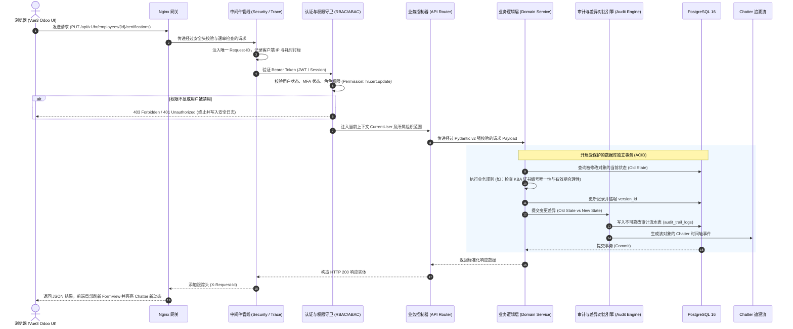

# 01 - 系统总体架构与程序执行结构 (Architecture & Execution Lifecycle)

---

## 1. 系统总体架构全景拓扑

Bravio ERP 采用 **模块化单体（Modular Monolith）** 配合 **前后端分离** 的系统架构。
该模式兼具单体部署的简便性与微服务的强模块解耦特性，非常利于初创企业高效迭代与未来平滑演进。

```
                         [ 用户浏览器 / 管理员终端 ]
                                    │
                                    ▼ (HTTPS / WSS)
                 ┌───────────────────────────────────────┐
                 │          Nginx 统一接入网关           │
                 │   - SSL/TLS 终止                      │
                 │   - 静态前端 SPA 托管 (缓存加速)      │
                 │   - 反向代理 /api/* -> 后端服务       │
                 │   - 请求速率限制 (Rate Limiting)      │
                 └──────────────────┬────────────────────┘
                                    │
                      ┌─────────────┴─────────────┐
                      ▼                           ▼
          ┌───────────────────────┐   ┌───────────────────────┐
          │  前端应用 (Vue3 SPA)  │   │ 后端核心 (FastAPI)    │
          │  - Odoo 交互设计系统  │   │  - 异步处理引擎       │
          │  - 响应式状态中心     │   │  - OpenAPI 规范契约   │
          │  - 本地令牌安全存储   │   │  - 中间件拦截管线     │
          └───────────────────────┘   └───────────┬───────────┘
                                                  │
                 ┌────────────────────────────────┴────────────────────────┐
                 ▼                                                         ▼
    ┌───────────────────────────┐                            ┌───────────────────────────┐
    │    企业级业务模块中心     │                            │    后台支撑与自动化服务   │
    │  - 系统安全与 RBAC 模块   │                            │  - 异步任务执行器 (Celery)│
    │  - 人员组织与资质模块     │                            │  - 自动备份与健康探针     │
    │  - ISO/KBA 审计与追溯中心 │                            │  - 邮件与预警推送服务     │
    │  - (后续扩展业务模块...)  │                            └─────────────┬─────────────┘
    └─────────────┬─────────────┘                                          │
                  │                                                        │
                  └───────────────────────────┬────────────────────────────┘
                                              ▼
                        ┌───────────────────────────────────────────┐
                        │          数据持久化与一致性层             │
                        │                                           │
                        │  ┌─────────────────────────────────────┐  │
                        │  │  PostgreSQL 16 企业数据库           │  │
                        │  │  - 强 ACID 事务保证                 │  │
                        │  │  - 预写日志 (WAL Archiving)         │  │
                        │  │  - 不可篡改变更审计表               │  │
                        │  └──────────────────┬──────────────────┘  │
                        │                     │                     │
                        │  ┌──────────────────┴──────────────────┐  │
                        │  │  Redis 7 (缓存/Session/令牌黑名单)  │  │
                        │  └─────────────────────────────────────┘  │
                        └─────────────────────┬─────────────────────┘
                                              │
                                              ▼
                        ┌───────────────────────────────────────────┐
                        │       持久卷与本地容灾快照系统            │
                        │  - Postgres_Data 宿主机安全卷             │
                        │  - Backups_Archive (带 SHA256 离线包)     │
                        │  - 外部 VPS 卷级一致性快照                │
                        └───────────────────────────────────────────┘
```

---

## 2. 请求处理生命周期（Request Execution Lifecycle）

一个针对 Bravio ERP 的典型业务请求（例如：“HR管理员修改某员工资质信息”）在后端的完整处理流如下：



---

## 3. 后端执行骨架（FastAPI 现代化工程架构）

后端采用严格分层的 **领域驱动（DDD）+ 依赖注入（Dependency Injection）** 模式构建，规避传统 Python 脚本混乱问题：

```text
backend/app/
├── api/                         # 统一路由出口
│   ├── v1/                      # API 版本控制 (确保对外或客户端兼容)
│   │   ├── api.py               # 路由汇总装配
│   │   └── endpoints/           # 各模块路由分发
│   └── deps.py                  # 全局依赖注入 (get_db, get_current_user, check_perm)
│
├── core/                        # 系统核心基础设施
│   ├── config.py                # Pydantic Settings 环境配置注入
│   ├── database.py              # 异步引擎、连接池与 Session 事务管理
│   ├── security.py              # Argon2 散列、JWT 生成校验、TOTP 生成验证
│   ├── exceptions.py            # 全局统一异常定义与处理
│   └── middlewares.py           # 请求跟踪、耗时分析、安全防御中间件
│
├── models/                      # 全局抽象底层模型
│   ├── base.py                  # BaseAuditModel 抽象基类 (UUID主键, 创建/修改/软删除/乐观锁version_id)
│   └── audit.py                 # 全局不可篡改审计日志模型
│
├── modules/                     # 领域业务模块 (自包含，完全解耦)
│   ├── system_auth/             # 认证域：登录、2FA、令牌刷新、会话管控
│   ├── rbac/                    # 权限域：用户、角色、权限树、数据规则
│   ├── hr_employees/            # 人力组织域：部门、岗位、员工、ISO/KBA资质
│   ├── audit_center/            # 审计域：全局日志检索、合规导出、Chatter 聚合
│   ├── system_backup/           # 灾备域：备份触发、归档管理、下载与回滚控制
│   ├── print_engine/            # 【审计补全】工业打印域：ZPL/TSPL 模板管理与工位打印代理
│   ├── notification_center/     # 【审计补全】预警与待办域：资质到期、8D倒计时、阈值报警
│   └── sequence_engine/         # 【审计补全】单据号引擎：高并发防跳号、防重号流水发生器
│
└── main.py                      # FastAPI 入口启动引导文件
```

### 3.1 统一通用实体基类标准 (`BaseAuditModel`)

为确保整个系统数据模型高度整洁且便于维护，所有业务模型（除 32 位激光码单品自然主键外）统一遵循以下基类规范：

```python
# 概念模型伪代码 (Python / SQLAlchemy 2.0 规范说明)
class BaseAuditModel:
    id: UUID = Field(default_factory=uuid4, primary_key=True)
    created_at: datetime = Field(default_factory=datetime.utcnow)
    created_by_id: Optional[UUID] = None
    updated_at: datetime = Field(default_factory=datetime.utcnow)
    updated_by_id: Optional[UUID] = None
    is_deleted: bool = Field(default=False)
    version_id: int = Field(default=1)  # 乐观锁控制，防止并发覆盖
```


---

## 4. 容器化多服务拓扑（Docker Compose 部署模型）

为确保**一键部署、环境一致与数据安全**，系统通过 `docker-compose` 编排以下互相隔离的容器服务：

| 容器服务名 | 基础镜像 | 职责定位 | 存储卷与网络隔离 |
| :--- | :--- | :--- | :--- |
| **`bravio-web`** | `nginx:alpine` | 前端静态页面托管、SSL 接入、反代路由 | 挂载编译产物与 nginx.conf，暴露 80/443 |
| **`bravio-api`** | `python:3.11-slim` | FastAPI 后端服务（Uvicorn 驱动多工作进程） | 内部隔离网络，挂载媒体/附件持久卷 |
| **`bravio-db`** | `postgres:16-alpine`| 主数据库，预配 WAL 级别为 replica | 挂载持久卷 `pg_data`，禁止外部直接端口暴露 |
| **`bravio-redis`**| `redis:7-alpine` | 缓存与快速令牌黑名单 | 内部隔离网络 |
| **`bravio-backup`**| `alpine:latest` | 定时全量备份守护脚本（带 SHA256 与保留周期） | 挂载 `backups_archive` 独立卷及主库 socket |

所有服务处于专用的内部 Docker Bridge 网络中，仅网关（Web）对外暴露加密端口，确保未授权者根本无法直接扫描或嗅探数据库端口。
