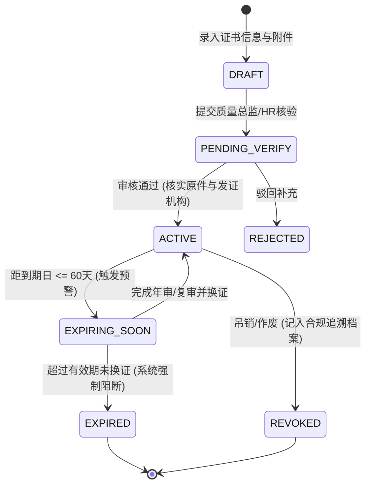

# 04 - 人员组织与合规资质管理规范 (Personnel & Competency Matrix)

---

## 1. 业务全景与合规重要性

在制造型企业尤其是通过 **ISO 9001**（第 7.2 条“能力”与第 7.3 条“意识”）与 **德国 KBA Type Approval** 认证的企业中，人员管理绝不仅是简单的“花名册”，而是**整个质量体系与生产一致性（CoP）合格运转的前提**。

### 核心合规痛点
1. **关键特殊特性工位（Special Characteristics）**：涉及安全件、关键结构或 ECE 标准检测的岗位，操作人员必须具备有效资质与授权。
2. **资质过期失控**：审核员抽查时，若发现某份关键检验报告是由资质已过期 3 天的质检员签署，可能直接导致严重不符合项（Major Non-Conformity）甚至吊销证书。
3. **培训与有效性评估缺失**：ISO 9001 明确要求组织应评估培训措施的有效性，并保留相应成文信息。

---

## 2. 组织架构与人员实体模型 (ER Modeling)

```
┌─────────────────────────────────┐
│        hr_departments           │ (部门树形结构)
│ - id: UUID                      │
│ - code: VARCHAR (如: DEPT-QA)   │
│ - name: VARCHAR (质量保证部)    │
│ - parent_id: UUID (自引用树)    │
│ - manager_id: UUID (部门长)     │
│ - iso_process_type: ENUM        │ (核心过程/管理过程/支持过程)
└────────────────┬────────────────┘
                 │ 1:N
                 ▼
┌─────────────────────────────────┐           ┌─────────────────────────────────┐
│        hr_job_positions         │           │           sys_users             │
│ - id: UUID                      │           │ (系统登录账号)                  │
│ - department_id: UUID           │           │ - id: UUID                      │
│ - title: VARCHAR (KBA合规专员)  │           │ - username: VARCHAR             │
│ - is_safety_critical: BOOLEAN   │           │ - email: VARCHAR                │
│ - required_cert_types: JSONB    │           │ - is_active: BOOLEAN            │
└────────────────┬────────────────┘           └────────────────┬────────────────┘
                 │ 1:N                                         │ 1:1 (可选)
                 ▼                                             ▼
┌───────────────────────────────────────────────────────────────────────────────┐
│                               hr_employees                                    │
│ - id: UUID                                                                    │
│ - employee_no: VARCHAR (工号，如: BR-2026-001)                                 │
│ - name: VARCHAR (姓名)                                                        │
│ - email: VARCHAR (工作邮箱)                                                   │
│ - phone: VARCHAR (联系电话)                                                   │
│ - department_id: UUID (所属部门)                                              │
│ - job_id: UUID (当前岗位)                                                     │
│ - manager_id: UUID (直接汇报人)                                               │
│ - status: ENUM (DRAFT, PROBATION, ACTIVE, ON_LEAVE, RESIGNED)                 │
│ - user_id: UUID (绑定的系统登录账号，实现人员与系统账号解耦)                  │
└───────────────────────┬───────────────────────────────────────────────────────┘
                        │
                        ├───────────────────────────────────────┐
                        │ 1:N                                   │ 1:N
                        ▼                                       ▼
┌───────────────────────────────────────┐   ┌───────────────────────────────────┐
│       hr_employee_certifications      │   │       hr_employee_trainings       │
│ (ISO / KBA 资质与上岗证书矩阵)        │   │ (培训履历与有效性评价)            │
│ - id: UUID                            │   │ - id: UUID                        │
│ - employee_id: UUID                   │   │ - employee_id: UUID               │
│ - cert_type: VARCHAR (如: KBA-CoP)    │   │ - topic: VARCHAR (如: ECE标准研讨)│
│ - cert_name: VARCHAR (KBA内审员证书)  │   │ - training_date: DATE             │
│ - cert_number: VARCHAR (唯一证书编号) │   │ - trainer: VARCHAR (培训讲师)     │
│ - issuing_body: VARCHAR (TÜV / VDA)   │   │ - hours: NUMERIC                  │
│ - issue_date: DATE                    │   │ - assessment_score: NUMERIC (考核)│
│ - expiry_date: DATE (到期日，可为永久)│   │ - effectiveness_eval: TEXT (评价) │
│ - attachment_path: VARCHAR (证书扫描件│   │ - status: ENUM (PLANNED, PASSED)  │
│ - audit_status: ENUM (待核验/有效/作废│   └───────────────────────────────────┘
└───────────────────────────────────────┘
```

---

## 3. 资质矩阵预警与合规闭环逻辑 (Competency & Alerting)

### 3.1 证书生命周期状态机



### 3.2 自动化合规守护与预警机制
1. **三级红黄绿预警机制**：
   - 🟢 **正常生效 (Active)**：有效期 > 60 天。
   - 🟡 **黄灯预警 (Expiring Soon)**：距到期日 $\le 60$ 天，系统自动在员工 Chatter 及质量负责人工作台生成“资质复审待办任务（Activity）”，并推送邮件提醒。
   - 🔴 **红灯阻断 (Expired)**：一旦证书过期，系统状态自动变更为 `EXPIRED`。若该员工绑定了关键岗位，系统将在出具相关检验单据时**弹出合规阻断提示**，不允许无资质签发检验记录。
2. **资质防篡改存证**：
   - 每一张上传的资质证明（PDF/高清图片）在入库时由后台计算其唯一 **SHA-256 哈希散列**并锁定，防止文件在服务器存储介质中被隐蔽替换。

---

## 4. Odoo 风格人员管理界面规格 (UI Specifications)

### 4.1 员工列表视图 (ListView)
- **表头字段**：工号、姓名、部门、岗位、直接上级、工作邮箱、状态、资质健康度徽章、创建时间。
- **快捷过滤器 (Filters)**：
  - `在职员工 (Active)`
  - `持有 KBA 资质 (Has KBA Cert)`
  - `⚠️ 资质即将到期/已过期 (Cert Issues)`
- **分组 (Group By)**：
  - 按 `部门 (Department)` 折叠查看。
  - 按 `岗位 (Job Position)` 分类统计。

### 4.2 员工表单详情视图 (FormView)
- **头部控制栏**：
  - 状态管道展示：`[ 试用期 ] -> [ 正式员工 ] -> [ 离职 ]`。
  - 操作按钮：`[ 编辑 ]`、`[ 重置系统密码 ]`、`[ 打印员工合规档案 ]`。
- **右上角智能按钮 (Smart Buttons)**：
  - `[ 🪪 3 项资质证书 ]`（点击直接下钻至该员工的证书列表）。
  - `[ 📚 5 次受训记录 ]`。
  - `[ 🔐 系统账号：已启用 ]`。
- **卡片主体 (Paper Sheet)**：
  - 顶部左侧：员工高清免冠照片上传控件。
  - 顶部右侧：姓名（大字号 H1）、工号胶囊标签、岗位标签。
  - 标签页 (Tabs)：
    1. **`工作档案 (Work Information)`**：部门、上级、办公地点、入职日期、合同类型。
    2. **`ISO/KBA 资质矩阵 (Qualifications)`**：内嵌证书表格，支持直接预览附件与核验状态。
    3. **`系统与权限 (System Access)`**：关联的 `sys_users` 账号、所属角色、数据访问范围。
- **右侧 Chatter 栏**：
  - 记录对该员工所有信息改动（调岗、调薪、证书更新）的自动审计流水；支持 HR 与主管记录内部考核备忘录。
