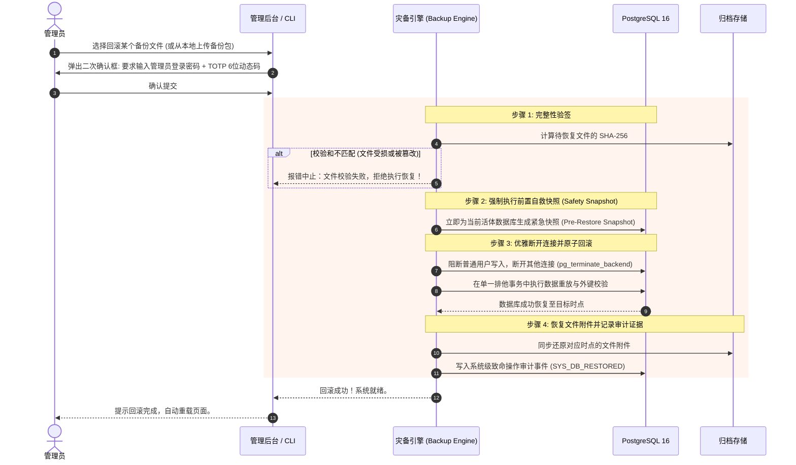

# 05 - 数据库一致性、容灾备份与安全回滚机制 (Data Durability & Backup/Restore)

---

## 1. 核心诉求与设计定位

用户的关键原则：  
> **“在数据库一致性上有企业级管理，并非需要加密，而是确保数据绝对不会丢。可以使用 VPS 的快照，也允许我作为管理员下载独立文件在本地保存，并随时安全回滚。”**

为此，Bravio ERP 抛弃花哨脆弱的专有黑盒加密，采用工业界经历数十年检验的 **PostgreSQL 16 强一致性内核 + 三层立体容灾与本地归档系统**。

---

## 2. 数据库零数据丢失与一致性保障（Consistency Architecture）

```
                         [ 业务写请求 (Insert/Update) ]
                                       │
                                       ▼
                   ┌───────────────────────────────────────┐
                   │    PostgreSQL 16 数据库内核引擎       │
                   ├───────────────────────────────────────┤
                   │ 1. 内存共享缓冲区 (Shared Buffers)    │
                   │ 2. 预写日志引擎 (WAL Engine)          │
                   │    - 每次 Commit 立即 fsync 刷盘      │
                   │    - 即使服务器遭遇强行断电拔插头，   │
                   │      重启后依据 WAL 毫秒级重放自愈    │
                   │ 3. 严格事务隔离 (Read Committed/ACID) │
                   │ 4. 行级乐观锁版本控制 (version_id)    │
                   └──────────────────┬────────────────────┘
                                      │
                                      ▼
                   ┌───────────────────────────────────────┐
                   │        宿主机 Docker 独立持久卷       │
                   │        /var/lib/postgresql/data       │
                   └───────────────────────────────────────┘
```

### 2.1 一致性保障五大支柱
1. **WAL (Write-Ahead Logging) 预写日志与全量刷盘**：
   - 数据库配置 `wal_level = replica`，`synchronous_commit = on`。所有的事务变更在应用到数据表前必须先写入磁盘 WAL 日志，从物理上消除断电脏数据风险。
2. **企业级外键完整性约束 (Foreign Keys)**：
   - 不允许孤儿数据（Orphan Records）。合规关联表（如：员工-资质、审批-审计流水）由数据库底层强外键级联或保护阻断，杜绝应用层 Bug 破坏数据一致性。
3. **软删除（Soft Delete）防误删兜底**：
   - 所有业务数据表均具备 `is_deleted`、`deleted_at`、`deleted_by_id` 标志。
   - 系统中所谓的“删除”操作默认均为合规软删除，即便误操作也能在后台瞬间恢复。
4. **行级并发版本控制（Optimistic Locking）**：
   - 每一条业务记录维护递增的 `version_id`。如果两个管理员同时修改同一份单据，先提交者成功，后提交者收到冲突警告并刷新，防止后写覆盖前写。
5. **VPS 整机/云盘快照友好设计**：
   - 数据库文件存储严格独立于应用代码，统一存放在持久卷中。支持随时在云控制台（如阿里云、腾讯云、Hetzner、AWS）直接对 VPS 磁盘打快照。

---

## 3. 独立归档包规范（Standalone Backup Archive）

系统支持将系统全量数据（结构、数据、序列、配置及文件附件）打包为标准独立归档文件：  
**文件命名规范**：`bravio_backup_YYYYMMDD_HHMMSS_v1.0.tar.gz`

### 3.1 归档包内部解剖结构
```text
bravio_backup_20261017_120000_v1.0.tar.gz
├── manifest.json              # 备份元数据 (版本、大小、生成人、校验和)
├── database_dump.sql.gz       # PostgreSQL 完整逻辑转储 (pg_dump 压缩版)
├── attachments/               # 员工证书扫描件、PDF 报告等物理附件
└── checksum.sha256            # 整个包及各子项的 SHA256 签名散列
```

### 3.2 归档清单 `manifest.json` 规范样例
```json
{
  "system": "Bravio ERP",
  "system_version": "1.0.0",
  "database_version": "PostgreSQL 16.4",
  "git_commit": "a1b2c3d4e5f6",
  "created_at": "2026-10-17T12:00:00Z",
  "created_by": "admin (Super Administrator)",
  "scope": "FULL_INSTANCE",
  "tables_count": 48,
  "records_count": 15420,
  "attachments_count": 320,
  "sha256_hash": "e3b0c44298fc1c149afbf4c8996fb92427ae41e4649b934ca495991b7852b855"
}
```

---

## 4. 管理员操作：一键导出下载与安全回滚 (Admin Web & CLI)

### 4.1 管理员在 Web 控制台的导出与下载流程
1. 进入 **系统设置 -> 灾备与数据韧性控制台 (Disaster Recovery)**。
2. 点击 **`[ 立即生成全量备份归档 ]`**：
   - 系统后台守护进程执行 `pg_dump`，打包附件目录，生成 SHA256 校验码。
   - 生成完毕后进入历史归档列表。
3. 点击 **`[ ⬇ 下载至本地电脑 ]`**：
   - 浏览器以高速流式传输该 `.tar.gz` 独立文件。管理员可保存在本地电脑、NAS 或离线移动硬盘，无需依赖云服务商。

### 4.2 企业级安全回滚机制（Rollback with Zero Hazard）

为防止管理员“回滚错文件”造成灾难，回滚流程设计了**前置安全护盾（Pre-restore Safety Shield）**：



---

## 5. 灾备常用 CLI 指令（备用命令行运维）

除 Web 界面外，在服务器后台仅需一行指令即可完成手动触发：

```bash
# 1. 命令行立即生成独立备份并打印校验码
docker exec -t bravio-backup /scripts/backup.sh

# 2. 命令行执行指定归档回滚 (自动带前置自救快照)
docker exec -t bravio-backup /scripts/restore.sh /backups/bravio_backup_20261017_120000_v1.0.tar.gz

# 3. 将服务器备份直接安全拷贝到本地电脑 (在本地终端运行)
scp user@your-vps-ip:/var/bravio-erp/backups/bravio_backup_*.tar.gz D:/bravio_offline_backups/
```
