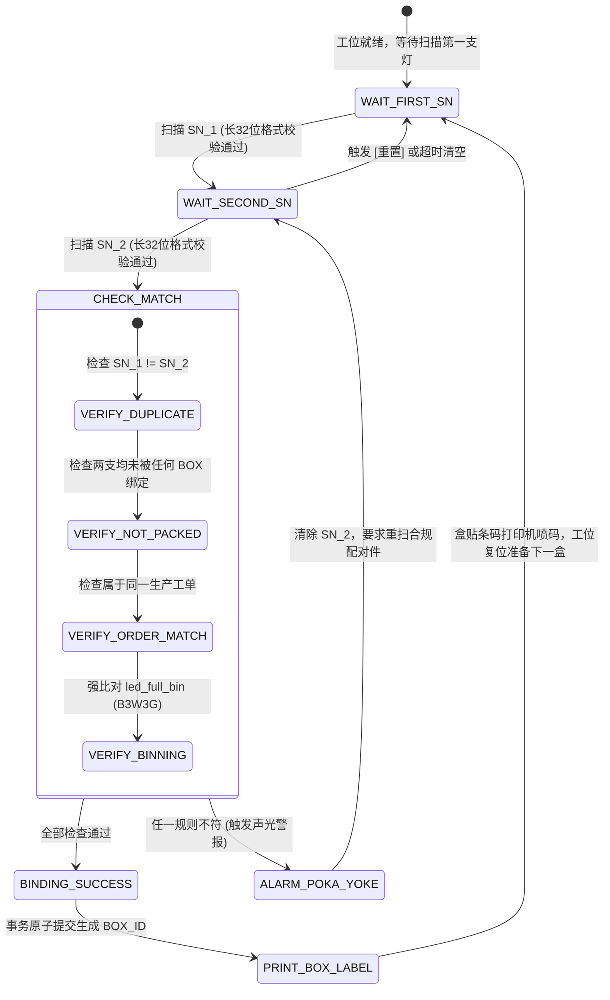

# 07 - 32位激光微距码与双灯配对防呆规范 (SN Code & Binning Poka-Yoke)

---

## 1. 32 位激光码（DataMatrix）编码全景定义

每一支 Bravio 车灯产品在 SMT 贴片及总成终检合格后，由高精度微距激光雕刻机在金属散热底座/特定结构面雕刻 **32 位 DataMatrix 矩阵码**。  
该序列号（`sn_code`）为产品的唯一法定数字身份证，贯穿从供应商制造、包装、跨国海运、德国仓质检、分销出库、直至售后 RMA 的全生命周期。

### 1.1 32 位字符切片结构与物理语义（严格遵守）

> **规范定义**：编码长度恒定为 **32 位 ASCII 字符**。  
> 索引定义：0-based 对应应用层切片，1-based 对应 PostgreSQL `SUBSTRING` 函数。

| 字段语义标识 | 0-based 索引 | SQL `SUBSTRING(sn_code FROM x FOR y)` | 字符长度 | 数据类型 | 典型示例 | 详细工业语义说明 |
| :--- | :--- | :--- | :---: | :---: | :--- | :--- |
| `bravio_id` | `[0..4]` | `FROM 1 FOR 5` | 5 | `CHAR(5)` | `99824` | **BRAVIO 硬件零件号**（对应车型车灯产品线顶级料号） |
| `revision` | `[5]` | `FROM 6 FOR 1` | 1 | `CHAR(1)` | `A` | **硬件图纸修订版号**（KBA 变更受控核心字段，如 A, B, C） |
| `ebom_code` | `[6..9]` | `FROM 7 FOR 4` | 4 | `CHAR(4)` | `0013` | **供应商 eBOM 代码**（唯一锁定代工厂生产基地及 BOM 版本） |
| `prod_yyww` | `[10..13]` | `FROM 11 FOR 4` | 4 | `CHAR(4)` | `2550` | **生产年份与周次**（YY=25 年，WW=50 周，德国实验室留样检索基准） |
| `rolling_no` | `[14..18]` | `FROM 15 FOR 5` | 5 | `CHAR(5)` | `01208` | **当周递增流水号**（单班次/单周内从 00001 至 99999 唯一流水） |
| `hw_ver` | `[19..20]` | `FROM 20 FOR 2` | 2 | `CHAR(2)` | `02` | **当前硬件与固件版本**（驱动板电气版本号） |
| `led_pn` | `[21..26]` | `FROM 22 FOR 6` | 6 | `CHAR(6)` | `SZ8Y19` | **LED 发光芯片型号代码**（如首尔半导体、欧司朗专有代码） |
| `led_color_bin`| `[27..28]` | `FROM 28 FOR 2` | 2 | `CHAR(2)` | `B3` | **LED 色温/色坐标档位**（如 6000K 细分色度容差圈） |
| `led_flux_bin` | `[29..30]` | `FROM 30 FOR 2` | 2 | `CHAR(2)` | `W3` | **LED 光通量/亮度档位**（Lumen 输出流明区间） |
| `led_vf_bin` | `[31]` | `FROM 32 FOR 1` | 1 | `CHAR(1)` | `G` | **LED 正向导通电压档位**（Forward Voltage 压降区间） |
| **`led_full_bin`**| `[27..31]` | `FROM 28 FOR 5` | 5 | `CHAR(5)` | `B3W3G` | **LED 综合物理分档（Binning）**：同盒双支强制配对校验元 |

---

## 2. 数据库持久计算列设计（PostgreSQL STORED Generated Columns）

系统坚决杜绝在每次查询或报表时进行反复截取计算，利用 PostgreSQL 16 的 `GENERATED ALWAYS AS ... STORED` 特性，在激光码写入数据库的一瞬间完成物理索引列物化：

```sql
-- 核心产品单品表 (Product Items)
CREATE TABLE product_items (
    sn_code CHAR(32) PRIMARY KEY,
    
    -- 依据 32 位规范物理存储的生成列 (STORED Generated Columns)
    bravio_id       CHAR(5) GENERATED ALWAYS AS (SUBSTRING(sn_code FROM 1 FOR 5)) STORED,
    revision        CHAR(1) GENERATED ALWAYS AS (SUBSTRING(sn_code FROM 6 FOR 1)) STORED,
    ebom_code       CHAR(4) GENERATED ALWAYS AS (SUBSTRING(sn_code FROM 7 FOR 4)) STORED,
    prod_yyww       CHAR(4) GENERATED ALWAYS AS (SUBSTRING(sn_code FROM 11 FOR 4)) STORED,
    rolling_no      CHAR(5) GENERATED ALWAYS AS (SUBSTRING(sn_code FROM 15 FOR 5)) STORED,
    hw_ver          CHAR(2) GENERATED ALWAYS AS (SUBSTRING(sn_code FROM 20 FOR 2)) STORED,
    led_pn          CHAR(6) GENERATED ALWAYS AS (SUBSTRING(sn_code FROM 22 FOR 6)) STORED,
    led_color_bin   CHAR(2) GENERATED ALWAYS AS (SUBSTRING(sn_code FROM 28 FOR 2)) STORED,
    led_flux_bin    CHAR(2) GENERATED ALWAYS AS (SUBSTRING(sn_code FROM 30 FOR 2)) STORED,
    led_vf_bin      CHAR(1) GENERATED ALWAYS AS (SUBSTRING(sn_code FROM 32 FOR 1)) STORED,
    led_full_bin    CHAR(5) GENERATED ALWAYS AS (SUBSTRING(sn_code FROM 28 FOR 5)) STORED,

    -- 业务关联与包装指针
    order_no        VARCHAR(32) NOT NULL REFERENCES production_orders(order_no),
    box_id          VARCHAR(40) REFERENCES packaging_units(pack_id),
    original_box_id VARCHAR(40) NOT NULL, -- 出厂初始彩盒ID (防伪造、防换盒欺诈溯源锚点)
    twin_sn_code    CHAR(32),             -- 同盒孪生车灯 SN 码 (死绑定配对指针)
    
    -- 状态与流转
    item_status     item_status_enum DEFAULT 'PRODUCED',
    current_owner_id VARCHAR(32) REFERENCES partners(partner_id), -- 法定所有权人 (客户/合作伙伴代码)
    current_warehouse_id VARCHAR(32) REFERENCES warehouses(warehouse_id), -- 物理所在仓库 (例: DE_CENTRAL_WH)
    current_location_id VARCHAR(50) REFERENCES stock_locations(location_id), -- 物理具体货架 (例: DE-MUC-LAB-RACK-03-B2)
    outbound_order_no VARCHAR(50),
    shipped_to_partner_at TIMESTAMPTZ,
    end_user_activated_at TIMESTAMPTZ,
    warranty_expires_at TIMESTAMPTZ,
    sample_rack_location VARCHAR(50),     -- 德国慕尼黑实验室留样库位镜像 (兼容历史直接标引)
    
    created_at      TIMESTAMPTZ DEFAULT CURRENT_TIMESTAMP,
    updated_at      TIMESTAMPTZ DEFAULT CURRENT_TIMESTAMP,
    
    CONSTRAINT chk_sn_length CHECK (char_length(sn_code) = 32)
);

-- 高并发检索索引
CREATE INDEX idx_product_items_yyww ON product_items(prod_yyww);
CREATE INDEX idx_product_items_full_bin ON product_items(led_full_bin);
CREATE INDEX idx_product_items_box ON product_items(box_id);
CREATE INDEX idx_product_items_status ON product_items(item_status);
CREATE INDEX idx_product_items_owner ON product_items(current_owner_id);
CREATE INDEX idx_product_items_wh_loc ON product_items(current_warehouse_id, current_location_id);
```

---

## 3. 一盒两支光色配对防呆机制（Binning Matching Poka-Yoke）

### 3.1 物理业务背景与工位痛点
- 汽车头灯/照明产品对光色一致性要求极高。如果同一零售彩盒内两支灯色温不一致（如一支偏冷蓝 6500K，一支偏暖白 5000K），装上车辆后将造成严重外观缺陷并引发终端强烈客诉。
- 彩盒封口并覆膜贴标后，**完全无法再扫描内部微距激光码**。
- 因此，包装工位是**唯一的配对死绑定关卡**。

### 3.2 包装工位状态机与执行逻辑



### 3.3 强校验比对算法矩阵 (Validation Matrix)

| 校验步骤 | 检查逻辑 | 失败触发后果 | 前端反馈 |
| :---: | :--- | :--- | :--- |
| **Step 1** | `len(sn_code) == 32` 且字符集符合 DataMatrix ASCII 规范 | 阻断提交，拒绝接收 | 屏幕爆红，短促双哔声 |
| **Step 2** | `SN_1 != SN_2`（防误扫同一支两次） | 阻断提交 | 屏幕爆红：“禁止扫描重复条码！” |
| **Step 3** | `SN_1.status == 'PRODUCED' AND SN_2.status == 'PRODUCED'` | 阻断提交（防止已入库或已被封盒产品二次装盒） | 屏幕爆红：“单品状态异常，已绑定其他彩盒！” |
| **Step 4** | `SN_1.order_no == SN_2.order_no` | 阻断提交（必须来自同一生产批次） | 屏幕爆黄：“工单不一致！” |
| **Step 5** | `SN_1.led_full_bin == SN_2.led_full_bin`<br>*(即 color_bin, flux_bin, vf_bin 必须 100% 相同)* | **核心防呆阻断！** 拒绝发卡并记录错配预警日志 | **全屏闪烁红屏！持续高频刺耳警报音！**<br>提示：“Binning 冲突：SN1=[B3W3G] vs SN2=[B2W2F]” |

### 3.4 事务原子提交与双向绑定 (Atomic Database Transaction)
当且仅当上述 5 项核查 100% 通过时，后端在单一受保护事务内执行：
1. 生成全局唯一彩盒编号 `BOX_ID = "BOX-" || TO_CHAR(NOW(), 'YYYYMMDD') || "-" || LPAD(NEXTVAL('seq_box_id')::TEXT, 6, '0')`。
2. 在 `packaging_units` 插入该彩盒实体：`pack_level='BOX'`, `expected_child_count=2`, `current_child_count=2`, `paired_led_bin=SN_1.led_full_bin`, `pack_status='INTACT'`。
3. 更新 `product_items`：
   - 将 `SN_1` 的 `box_id = BOX_ID`, `original_box_id = BOX_ID`, `twin_sn_code = SN_2`。
   - 将 `SN_2` 的 `box_id = BOX_ID`, `original_box_id = BOX_ID`, `twin_sn_code = SN_1`。
4. 触发工位标签打印机协议，自动输出格式化 `BOX_ID` 标签贴纸（包含：零件号、周次、配对 Binning 码、二维码及文本明文）。

---

## 4. 工业级包装工位前端防呆体验（Acoustic & Visual Feedback）

在嘈杂的制造车间与包装流水线，操作员依赖极简盲操。前端界面必须针对工业扫码枪定制：

1. **自动聚焦与扫码枪无感接入**：
   - 输入框永久锁定焦点（AutoFocus），扫码枪输入完成后自带 `\r\n`（Enter 键）直接触发事件，无需工人触碰鼠标。
2. **全屏防呆视觉反馈 (Visual Poka-Yoke)**：
   - **待机状态**：背景深沉工业蓝灰，大字号提示：`[ 请扫描第 1 支车灯激光码 ]`。
   - **第一支就绪**：背景转为亮蓝，居中展示：`SN_1 已就绪 | Binning: B3W3G | 请扫描第 2 支`。
   - **配对成功**：**全屏瞬间转为明亮翠绿（#10B981）**，展示超大号对勾与 `BOX_ID`，2 秒后自动复位。
   - **校验失败**：**全屏瞬间转为高危鲜红（#EF4444）**，界面弹出错误原因，并锁定屏幕 3 秒强制操作人员确认。
3. **Web Audio API 纯原生蜂鸣声效（无外置音频文件依赖）**：
   - **扫码单响（OK 提示）**：单次 800Hz 正弦波振荡，持续 80ms。
   - **封盒成功（配对完成）**：双音阶和谐提示（600Hz -> 1200Hz 悦耳升调）。
   - **防呆报警（错误拦截）**：低频锯齿波（250Hz -> 180Hz 循环交替 3 次，类似防空警报），音量强制最大。

---

## 5. 包装日常异常处置与单品作废销号流 (Exceptions & Scrap Pipeline)

### 5.1 包装破损受控换盒与防呆重绑流程 (Re-boxing Flow)
在制造厂包装流水线或海外仓二次分装中，若彩盒外表受压破损或标签被污损、但盒内两支单品车灯完好无损时：
1. **班组长权限介入**：切换至 `[ 异常换盒重贴 ]` 专属工作台；
2. **扫描原盒或任一单品**：系统根据 `box_id` 或 `sn_code` 自动锁定同盒孪生件对（`SN_1` 与 `SN_2`）；
3. **安全解绑与废旧彩盒作废**：
   - 将原彩盒 `pack_status` 置为 `'DISBANDED'` 并归档；
   - 强比对 `SN_1` 与 `SN_2` 的 `led_full_bin`，确认物理件未被串换；
4. **生成新彩盒码与重新绑定**：
   - 依据条码规则生成全新合规 `BOX-NEW`，将 `SN_1` 与 `SN_2` 的当前 `box_id` 指向 `BOX-NEW`；
   - 关键锚点：保持单品 `original_box_id` 历史不变，写入不可篡改审计日志与 `packaging_units` 变更履历。

### 5.2 产线备品损耗与 SN 作废销号流程 (Scrap Invalidation Flow)
1. **备品损耗场景**：生产工单按计划超发 2% 激光刻蚀流水号，部分单品在 SMT 贴片焊接或终检耐压击穿时报废；
2. **API 销号触发**：代工厂 MES 发送作废请求，传入故障单品 `sn_code` 与报废原因代码（如 `SMT_REFLOW_BURN`, `TEST_HIPOT_FAIL`）；
3. **单品状态终结**：系统将该单品 `item_status` 变更为 `'SCRAPPED_AT_SUPPLIER'`，并切断其后续绑定彩盒的权限，彻底杜绝作废条码被挪用至仿冒品或非受控次品。

