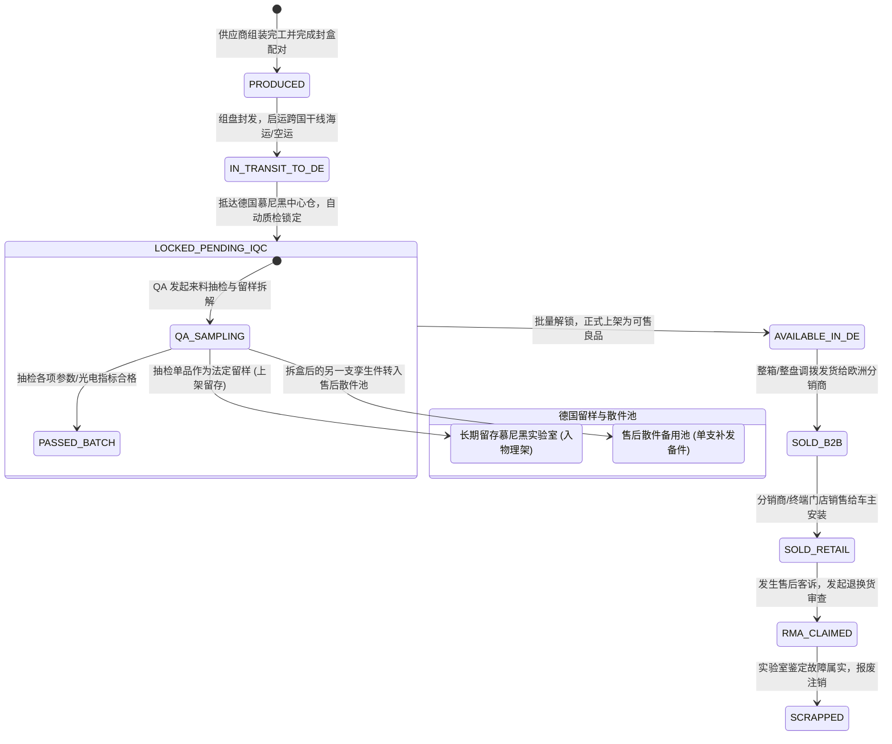
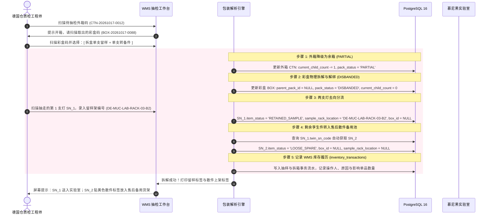

# 08 - 四级包装聚合树与全生命周期 WMS 规范 (Packaging Tree & WMS Lifecycle)

---

## 1. 四级包装树状聚合架构 (Multi-Level Aggregation)

在现代化汽车照明跨国供应链中，物流流转与出入库如果每次都去逐一扫描最内层的单品车灯，将导致仓储吞吐效率彻底崩溃。  
Bravio ERP 建立了完整的四级物理包装聚合树（Parent-Child Recursive Hierarchy）：

```
┌────────────────────────────────────────────────────────────────────────┐
│                   Level 4: 物流托盘 (PALLET - PLT)                      │
│                   标识码示例: PLT-20261017-0001                         │
│                   容量: 24 个外箱 (CARTON) / 共 960 支车灯              │
└───────────────────────────────────┬────────────────────────────────────┘
                                    │ 1:N 聚合关联
                                    ▼
┌────────────────────────────────────────────────────────────────────────┐
│                   Level 3: 运输外箱 (CARTON - CTN)                      │
│                   标识码示例: CTN-20261017-0012                         │
│                   容量: 20 个彩盒 (BOX) / 共 40 支车灯                  │
└───────────────────────────────────┬────────────────────────────────────┘
                                    │ 1:N 聚合关联
                                    ▼
┌────────────────────────────────────────────────────────────────────────┐
│                   Level 2: 零售彩盒 (BOX)                              │
│                   标识码示例: BOX-20261017-0088                         │
│                   容量: 2 支单品 (SN) / 同 Binning 强配对                │
└───────────────────────────────────┬────────────────────────────────────┘
                                    │ 1:2 死绑定
                                    ▼
┌────────────────────────────────────────────────────────────────────────┐
│                   Level 1: 单品激光码 (SN_CODE)                         │
│                   标识码示例: 99824A001325500120802SZ8Y19B3W3G          │
│                   物理形态: 车灯金属底座微距激光刻蚀 32 位 DataMatrix   │
└────────────────────────────────────────────────────────────────────────┘
```

---

## 2. 核心数据表实体模型设计 (Packaging & WMS Schemas)

系统通过规范化的关系模型支撑四级包装聚合与实体仓库库位管控：

```sql
CREATE TYPE pack_level_enum AS ENUM ('BOX', 'CARTON', 'PALLET');
CREATE TYPE pack_status_enum AS ENUM ('INTACT', 'PARTIAL', 'DISBANDED', 'SCRAPPED');

-- 1. 物理仓库主表
CREATE TABLE warehouses (
    warehouse_id VARCHAR(32) PRIMARY KEY,             -- 仓库代码，如: "DE_MUC_WH", "CN_DG_FACTORY_WH"
    warehouse_name VARCHAR(100) NOT NULL,             -- 仓库全称 (如: "德国慕尼黑中央保税与质检总仓")
    country_code CHAR(2) NOT NULL DEFAULT 'DE',
    address_text TEXT NOT NULL,
    is_bonded BOOLEAN DEFAULT FALSE,                  -- 是否为保税仓库 (涉及关税清关)
    is_active BOOLEAN DEFAULT TRUE,
    created_at TIMESTAMPTZ DEFAULT CURRENT_TIMESTAMP
);

-- 2. 细分物理库位表
CREATE TYPE location_type_enum AS ENUM (
    'RECEIVING', 'IQC_HOLDING', 'QUALIFIED_STOCK', 
    'LAB_RETAINED', 'LOOSE_SPARE', 'DEFECTIVE_QUARANTINE', 'SHIPPING_DOCK'
);

CREATE TABLE stock_locations (
    location_id VARCHAR(50) PRIMARY KEY,              -- 物理库位编号，例: "DE-MUC-LAB-RACK-03-B2"
    warehouse_id VARCHAR(32) NOT NULL REFERENCES warehouses(warehouse_id),
    location_name VARCHAR(100) NOT NULL,
    location_type location_type_enum NOT NULL,
    max_capacity_pallets INT DEFAULT 1,
    is_locked BOOLEAN DEFAULT FALSE,                  -- 盘点锁库标记
    created_at TIMESTAMPTZ DEFAULT CURRENT_TIMESTAMP
);

-- 3. 四级包装单元表 (邻接表自引用树)
CREATE TABLE packaging_units (
    pack_id VARCHAR(40) PRIMARY KEY,                  -- 包装条码 (例: BOX-20261017-0088, CTN-..., PLT-...)
    pack_level pack_level_enum NOT NULL,              -- 包装层级
    parent_pack_id VARCHAR(40) REFERENCES packaging_units(pack_id), -- 自引用父级条码
    
    expected_child_count INT NOT NULL,                -- 标称容量 (BOX=2, CTN=20, PLT=24)
    current_child_count INT NOT NULL,                 -- 当前实际存留子件数
    order_no VARCHAR(32) REFERENCES production_orders(order_no),
    paired_led_bin CHAR(5),                           -- 针对彩盒: 配对 Binning 码 (如: B3W3G)
    pack_status pack_status_enum DEFAULT 'INTACT',
    
    current_warehouse_id VARCHAR(32) REFERENCES warehouses(warehouse_id),
    current_location_id VARCHAR(50) REFERENCES stock_locations(location_id),
    
    created_at TIMESTAMPTZ DEFAULT CURRENT_TIMESTAMP,
    updated_at TIMESTAMPTZ DEFAULT CURRENT_TIMESTAMP
);

-- 4. WMS 库存与包装移动事务流水表
CREATE TYPE inv_tx_type_enum AS ENUM (
    'MFG_RECEIPT', 'EXPORT_OUTBOUND', 'IMPORT_INBOUND_LOCKED', 
    'IQC_DISBAND_SAMPLE', 'TRANSFER_TO_SPARE', 'B2B_SALES_OUTBOUND', 
    'RMA_RECEIPT_RETURN', 'SCRAP_DISPOSAL'
);

CREATE TABLE inventory_transactions (
    id UUID PRIMARY KEY DEFAULT gen_random_uuid(),
    tx_no VARCHAR(32) NOT NULL UNIQUE,
    tx_type inv_tx_type_enum NOT NULL,
    pack_id VARCHAR(40) REFERENCES packaging_units(pack_id),
    sn_code CHAR(32) REFERENCES product_items(sn_code),
    product_id UUID REFERENCES product_masters(id),
    from_warehouse_id VARCHAR(32) REFERENCES warehouses(warehouse_id),
    from_location_id VARCHAR(50) REFERENCES stock_locations(location_id),
    to_warehouse_id VARCHAR(32) REFERENCES warehouses(warehouse_id),
    to_location_id VARCHAR(50) REFERENCES stock_locations(location_id),
    qty INT NOT NULL DEFAULT 1,
    operator_id UUID NOT NULL,
    operator_name VARCHAR(100) NOT NULL,
    associated_doc_no VARCHAR(64),
    notes TEXT,
    occurred_at TIMESTAMPTZ NOT NULL DEFAULT clock_timestamp()
);

CREATE INDEX idx_pack_parent ON packaging_units(parent_pack_id);
CREATE INDEX idx_pack_level_status ON packaging_units(pack_level, pack_status);
CREATE INDEX idx_stock_loc_wh_type ON stock_locations(warehouse_id, location_type);
CREATE INDEX idx_inv_tx_pack_sn ON inventory_transactions(pack_id, sn_code);
```

---

## 3. 数据库递归穿透模型与 SQL CTE 执行逻辑

在 `packaging_units` 表中，外箱与托盘采用**邻接表（Adjacency List）结合自引用外键 (`parent_pack_id`)** 存储。

### 3.1 递归查询：自顶向下穿透（从托盘/外箱瞬间检索底下所有单品）
当海关清关、德国海外仓接收入库、或大分销商整托盘调拨时，扫码枪仅扫描托盘条码（如 `PLT-20261017-0001`），系统通过 PostgreSQL **`WITH RECURSIVE` 公用表表达式（CTE）** 毫秒级向下穿透：

```sql
-- 业务场景：扫描最外层托盘码，一键获取该托盘下所有层级的包装单号及全部单品 SN
WITH RECURSIVE packaging_tree AS (
    -- 锚点成员 (Anchor): 最外层被扫描的包装单元
    SELECT 
        pack_id, 
        pack_level, 
        parent_pack_id, 
        pack_status, 
        1 AS depth
    FROM packaging_units
    WHERE pack_id = 'PLT-20261017-0001'

    UNION ALL

    -- 递归成员 (Recursive): 逐层向下搜寻子包装 (托盘 -> 外箱 -> 彩盒)
    SELECT 
        child.pack_id, 
        child.pack_level, 
        child.parent_pack_id, 
        child.pack_status, 
        parent.depth + 1
    FROM packaging_units child
    INNER JOIN packaging_tree parent ON child.parent_pack_id = parent.pack_id
)
-- 最终穿透关联至最底层的单品车灯表 (product_items)
SELECT 
    tree.depth,
    tree.pack_level,
    tree.pack_id,
    p.sn_code,
    p.led_full_bin,
    p.item_status,
    p.current_owner_id
FROM packaging_tree tree
LEFT JOIN product_items p ON p.box_id = tree.pack_id
ORDER BY tree.depth, tree.pack_id;
```

### 2.2 批量状态原子穿透更新（Batch Status Propagation）
当德国仓库接收入库时，只需一条指令，底层全部 960 支车灯状态同步变为 `LOCKED_PENDING_IQC`：

```sql
WITH RECURSIVE sub_packs AS (
    SELECT pack_id FROM packaging_units WHERE pack_id = :scanned_pallet_id
    UNION ALL
    SELECT c.pack_id FROM packaging_units c
    INNER JOIN sub_packs p ON c.parent_pack_id = p.pack_id
)
UPDATE product_items
SET 
    item_status = 'LOCKED_PENDING_IQC',
    current_owner_id = 'DE_CENTRAL_WH',
    updated_at = CURRENT_TIMESTAMP
WHERE box_id IN (SELECT pack_id FROM sub_packs);
```

---

## 3. 全生命周期状态演进全景 (Lifecycle State Machine)

单品状态（`item_status_enum`）与包装状态（`pack_status_enum`）在跨国业务流中的演变矩阵：



---

## 4. 德国仓 IQC 抽检与破箱/拆盒留样机制 (Sampling & Disbanding)

### 4.1 业务背景与 KBA / ISO 9001 法定留样要求
根据德国 KBA 生产一致性（CoP）核查标准，制造厂每一生产周次（`prod_yyww`）必须在德国本地实验室保留法定比例的物理实物样品（Retained Samples），用于发生突发道路交通安全事故或寿命耐久性质疑时的追溯复验。

### 4.2 破箱与拆盒分解算法（Disassembly Logic）

当德国质检主管（QA Lead）在仓库执行抽检时，流程如下：



### 4.3 外箱降级状态机规则
- **`INTACT` (完整箱/托盘)**：所有预定数量的子件（`current_child_count == expected_child_count`）均原封未动。
- **`PARTIAL` (余箱/非整箱)**：被质检抽检或被拆零发货后，`current_child_count < expected_child_count`，包装状态自动标记为 `PARTIAL`。后续出库算法优先调度整箱，余箱归入散货备料区。
- **`DISBANDED` (已解体/解绑)**：彩盒封口被划开，两支灯被拆分独立存放，该彩盒逻辑生命周期终结，不可再次作为整盒销售。

---

## 5. 跨国在途集装箱追踪与 WMS 移库盘点 (Logistics & Stock Control)

### 5.1 海运在途集装箱追踪 (`shipment_containers`)
跨国海运航程长达 30~45 天，托盘在制造厂完工出运后进入集装箱装箱环节：
- 托盘聚合至特定集装箱号（`container_no`）及海运提单号（`bill_of_lading_no`）；
- 托盘状态打标为 `IN_TRANSIT_OCEAN`；
- 面向德国汉堡/鹿特丹海关预申报（AMS/ISF/ENS）时，系统支持按提单号一键穿透导出全部托盘、外箱及 32 位单品装箱报关清单。

### 5.2 仓库上架（Putaway）与周期性盘点（Cycle Count）
1. **货位上架流**：德国仓接收入库完成 IQC 抽检合格后，叉车工使用 PDA 扫描托盘码与目标合格品货架库位码（如 `DE-MUC-A-01-04`），系统同步更新 `packaging_units.current_location_id` 并记录 `inventory_transactions`；
2. **周期性盘点流**：
   - 支持按货架区域或按生产周次（`batch_yyww`）发起周期性静态盲盘；
   - 盘点期间相关库位标记 `is_locked = TRUE`，防止并发异动；
   - 输出盘盈盘亏对账单，由仓库主管与财务双签确认后生效，保障 ISO 9001 实物与账目 100% 吻合。

