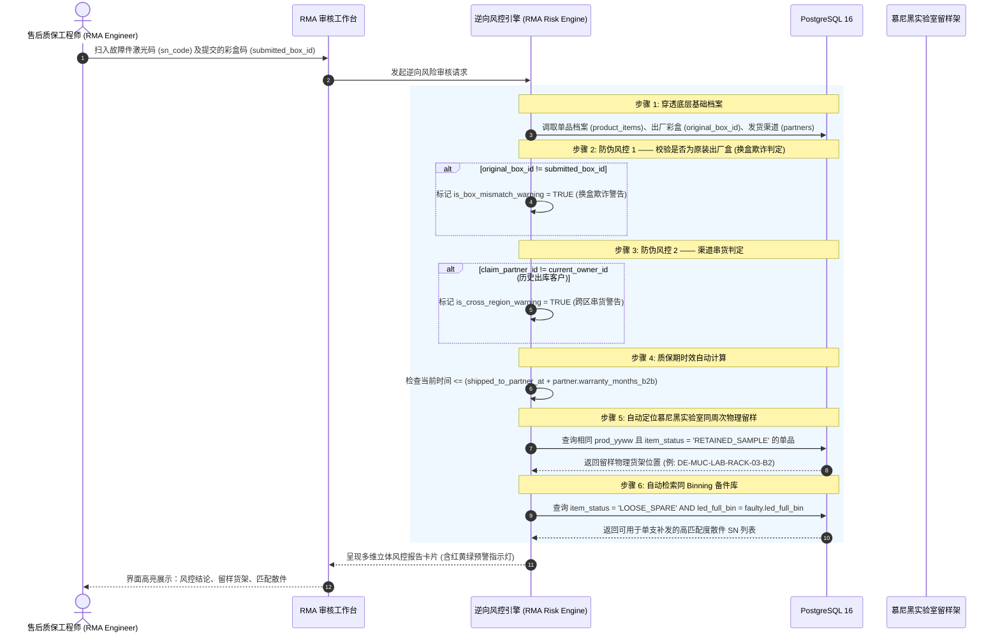

# 09 - 售后 RMA 逆向风控与合规追溯中枢 (RMA Reverse Risk Control & Lab Traceability)

---

## 1. 业务痛点与逆向工程风控模型

汽车照明后市场（Aftermarket & OEM Spare Parts）的售后返修与索赔存在严重的行业痛点：
1. **换盒欺诈（Box Tampering Fraud）**：黑心买家或不正规修理厂购买新批次车灯后，将 2 年前过保已烧毁的旧灯、甚至高仿假货塞入新包装盒内提交退换货索赔。
2. **跨区域串货（Grey Market Diversion）**：部分跨境分销商以低价在东欧/南欧市场提货，却伪造凭据在德国或北欧等高工时、高质量保障区申请原价质保赔偿。
3. **光色失配纠纷**：车主坏了一支灯，若厂家随便发一支不同 Binning（色温偏蓝或偏黄）的备件进行单支补发，装车后立刻造成“左右阴阳眼”，导致二次投诉。
4. **KBA 生产一致性事故（CoP Batch Recall）**：发生批量性早期失效时，必须在 24 小时内调出同批次（`prod_yyww`）在慕尼黑实验室的留样样品进行对比复测。

---

## 2. 单支扫码逆向穿透审计工作流 (Reverse RMA Audit Workflow)

当售后质保中心收到一支返修车灯时，售后工程师只需使用扫码枪扫描该车灯底座的 **32 位激光码（SN）** 并录入随附退回的彩盒码（`submitted_box_id`）：



---

## 3. 四大核心风控规则判定矩阵

### 3.1 规则 1：换盒欺诈拦截（Box Mismatch Detection）
- **核心判定**：`product_items.original_box_id == rma_claims.submitted_box_id`
- **逻辑**：出厂时两支灯与该彩盒是死绑定。若提交的彩盒条码与出厂记录不符，说明外包装被替换，系统亮起 **红色严重欺诈警告灯**，提示人工严查该灯是否为假冒伪劣仿品。

### 3.2 规则 2：跨区域串货核验（Cross-region Grey Market Detection）
- **核心判定**：追溯出库凭证 `outbound_order_no` 关联的原始受票方 `from_partner_id / to_partner_id`。
- **逻辑**：若该灯出库记录显示发往东欧代理商，而德国本土经销商申请质保赔偿，系统自动标记 `is_cross_region_warning = TRUE`，防止境内外价格与质保倒挂。

### 3.3 规则 3：同盒孪生件状态关联分析（Twin Lamp Diagnostics）
- **系统联动调阅**：自动调取 `twin_sn_code` 对应的另一支车灯的当前状态。
  - *若孪生件仍在市场正常运行*：判定为偶发性单灯硬件损坏；
  - *若孪生件在近期也提交了 RMA*：系统提示“同盒双灯短时间内双双失效”，高度怀疑车辆改装过压（如发电机故障）、供电浪涌或该批次电路设计存在共性缺陷。

### 3.4 规则 4：精准光色匹配备件调度算法（Binning-Matched Single Replacement）
- **背景**：为避免整盒报废的高昂成本，系统鼓励单支补发。但单支补发必须保证发出的备件光色与原车灯完全一致。
- **智能检索 SQL**：
```sql
-- 针对故障件 (SN_FAIL)，在德国本地散件备用池中搜寻完美匹配备件
SELECT 
    spare.sn_code,
    spare.bravio_id,
    spare.led_full_bin,
    spare.prod_yyww,
    spare.current_owner_id
FROM product_items spare
WHERE spare.item_status = 'LOOSE_SPARE'                    -- 必须属于售后散件池
  AND spare.bravio_id = :faulty_bravio_id                  -- 相同零件号
  AND spare.revision = :faulty_revision                    -- 相同图纸版次
  AND spare.led_full_bin = :faulty_led_full_bin            -- 核心：色温/光通量/电压 Binning 100% 严苛一致
ORDER BY 
    ABS(spare.prod_yyww::INT - :faulty_prod_yyww::INT) ASC -- 优先挑选生产周次最接近的批次
LIMIT 1;
```
找到匹配备件后，点击 `[ 确认补发 ]`，系统自动将该散件状态变更为 `SOLD_RETAIL`，并在 RMA 单据中绑定 `replacement_sn_code`。

---

## 4. 德国慕尼黑实验室留样联动与 KBA CoP 批量召回预警

```
                            [ RMA 索赔单据持续归档 ]
                                       │
                                       ▼
                  ┌─────────────────────────────────────────┐
                  │   同生产周次 (prod_yyww) 故障率监控引擎 │
                  └────────────────────┬────────────────────┘
                                       │
                    ┌──────────────────┴──────────────────┐
                    ▼                                     ▼
        [ 单周次故障率 < 0.1% ]               [ 单周次故障率 >= 0.5% (阈值) ]
                    │                                     │
                    ▼                                     ▼
             正常单件维修处置              ┌─────────────────────────────┐
                                           │  触发 KBA 生产一致性严重告警 │
                                           ├─────────────────────────────┤
                                           │ 1. 自动生成 CAPA 纠正防范单 │
                                           │ 2. 调出实验室留样对比复测   │
                                           │ 3. 锁定库存同批次在途/在库品│
                                           └─────────────────────────────┘
```

1. **秒级锁定留样物理库位**：
   - 界面一键显示：`同批次留样样品质检架：DE-MUC-LAB-RACK-03-B2`。
   - 德国实验室工程师无需在堆积如山的样品库翻找，直接按坐标取出留样件，架设在积分球与高温老化台上进行基准数据对比，排查是否属于批次性晶圆暗斑或焊膏空洞。
2. **KBA 合规归档报告导出**：
   - 系统支持一键导出包含 `32位单品码`、`装盒时间`、`供应商工厂`、`发货履历`、`失效现象`、`留样对比结论` 的标准 PDF 格式 **8D 质量报告**，随时迎检德国 KBA 官方审核官。

---

## 5. 售后 RMA 索赔单实体模型设计 (`rma_claims`)

```sql
CREATE TYPE rma_claim_status_enum AS ENUM (
    'CLAIM_SUBMITTED',     -- 收到售后客诉
    'PHYSICAL_RECEIVED',   -- 实物已收到并完成扫码
    'RISK_AUDIT_PASSED',   -- 逆向风控审核通过 (无欺诈、无跨区串货)
    'RISK_FRAUD_FLAGGED',  -- 触发高危拦截警告 (换盒/串货)
    'REPLACEMENT_SHIPPED', -- 同 Binning 备件已补发
    'LAB_ANALYZING_8D',    -- 移交实验室启动 8D 失效调查
    'CLOSED_RESOLVED',     -- 售后结案
    'REJECTED_RETURN'      -- 驳回退还客户
);

CREATE TABLE rma_claims (
    id UUID PRIMARY KEY DEFAULT gen_random_uuid(),
    claim_no VARCHAR(32) NOT NULL UNIQUE,             -- RMA 单号，例: "RMA-2026-0033"
    customer_id VARCHAR(32) NOT NULL REFERENCES partners(partner_id),
    
    -- 退回实物与比对锚点
    sn_code CHAR(32) NOT NULL REFERENCES product_items(sn_code),
    submitted_box_id VARCHAR(40),                     -- 客户随机附带退回的彩盒码
    
    -- 风控判定标记 (由风控规则引擎自动计算)
    is_box_mismatch_warning BOOLEAN DEFAULT FALSE,   -- 换盒欺诈警告
    is_cross_region_warning BOOLEAN DEFAULT FALSE,   -- 跨区串货警告
    is_warranty_expired BOOLEAN DEFAULT FALSE,       -- 是否已超质保期
    
    -- 关联留样与补偿
    matched_retained_sn CHAR(32) REFERENCES product_items(sn_code), -- 同批次留样件
    replacement_sn_code CHAR(32) REFERENCES product_items(sn_code), -- 补发的同Bin散件
    
    fault_symptom_category VARCHAR(50) NOT NULL,      -- 故障类别
    customer_complaint_desc TEXT NOT NULL,
    tech_investigation_note TEXT,
    
    status rma_claim_status_enum DEFAULT 'CLAIM_SUBMITTED',
    handled_by_id UUID,
    
    created_at TIMESTAMPTZ DEFAULT CURRENT_TIMESTAMP,
    created_by_id UUID,
    updated_at TIMESTAMPTZ DEFAULT CURRENT_TIMESTAMP,
    updated_by_id UUID,
    is_deleted BOOLEAN DEFAULT FALSE,
    version_id INT DEFAULT 1
);

CREATE INDEX idx_rma_sn ON rma_claims(sn_code);
CREATE INDEX idx_rma_customer ON rma_claims(customer_id);
CREATE INDEX idx_rma_status ON rma_claims(status);
```

---

## 6. 慕尼黑实验室留样生命周期终结与合规销毁 (Sample Disposal Lifecycle)

根据德国 KBA 生产一致性法规，法定留样通常要求保存至对应批次产品**停产后 2 年至 5 年**。随着周次累加，实验室物理留样架库位需受控流转腾退：
1. **留样保管年限监控**：系统基于 `prod_yyww` 与对应产品的生命周期状态（`lifecycle_status == 'END_OF_PRODUCTION_EOP'`），在保留期满前 90 天自动向质量合规官推送“留样处置待办”；
2. **销毁前合规会审**：质量总监审查该周次在欧洲市场近 3 年内无未决客诉、事故调查或质量官司后，签署电子销毁令；
3. **物理破坏与存证释放**：
   - 实验室工程师执行物理粉碎/拆解破坏，拍照上传销毁报告（Certificate of Destruction）；
   - 系统将该单品状态变更为 `'RETAINED_SAMPLE_DESTROYED'`，释放 `stock_locations` 对应留样架货位供新批次使用。

