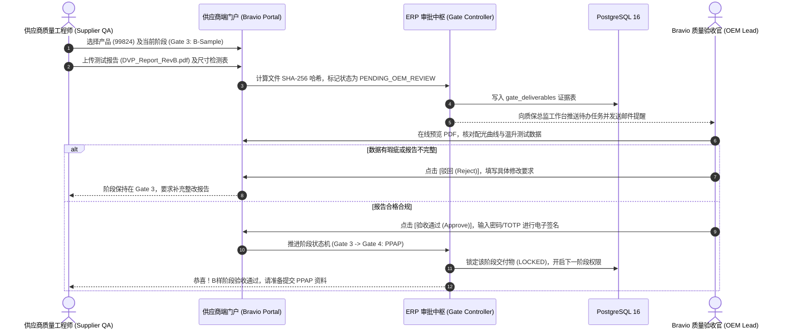

# 10 - 产品主数据与 APQP 阶段门生命周期管理 (Product Master & APQP Lifecycle)

---

## 1. 业务目标与汽车工业合规要求

在具有 **ISO 9001** 与 **德国 KBA Type Approval（型式认证）** 资质要求的汽车零部件企业中，产品不仅是一串料号，而是整个合规技术文档集（Technical Information Folder）的核心载体。  
本模块负责管控产品从**概念立项、A/B 样件验证、PPAP 签署批准、批量生产（SOP），直至停产退出（EOP）**的端到端生命周期。

---

## 2. 产品主数据模型与唯一性管理 (Product Master Data)

产品档案以极度严谨的方式记录产品的物理特性、资质归属与追溯配置：

```sql
CREATE TYPE product_lifecycle_status_enum AS ENUM (
    'PROJECT_KICKOFF',    -- 项目立项阶段
    'A_SAMPLE',           -- A样验证 (功能概念件)
    'B_SAMPLE',           -- B样验证 (设计验证 DVP)
    'PPAP_SIGN_OFF',      -- PPAP 签署 (过程验证 PVP / 试产件批准)
    'MASS_PRODUCTION_SOP',-- 量产中 (SOP / 生产一致性 CoP 监控)
    'END_OF_PRODUCTION_EOP'-- 停产归档 (EOP / 仅供售后备件)
);

CREATE TABLE product_masters (
    id UUID PRIMARY KEY DEFAULT gen_random_uuid(),
    
    -- 核心编号与唯一性管控
    bravio_id CHAR(5) NOT NULL UNIQUE,       -- BRAVIO 核心零件号 (5位唯一码，如: 99824)
    product_name VARCHAR(150) NOT NULL,      -- 产品商业与技术名称 (如: "LED Matrix Headlight Module Gen 2")
    current_revision CHAR(1) DEFAULT 'A',    -- 当前发布生效的图纸修订版号 (如: A, B, C)
    category VARCHAR(50) NOT NULL,           -- 产品大类: 'HEADLIGHT', 'DRL', 'TAILLIGHT', 'DRIVER_BOARD'
    
    -- 多媒体与技术图样
    primary_image_url TEXT,                  -- 产品正面高清渲染/实物图
    gallery_image_urls JSONB DEFAULT '[]',   -- 细节图、爆炸图、接口图集
    technical_spec_pdf_url TEXT,             -- 最终受控技术规格书 (Datasheet)
    
    -- KBA 认证与合规属性
    is_certified BOOLEAN DEFAULT TRUE,       -- 是否为法规认证件 (Type Approval Product)
    kba_approval_number VARCHAR(60),         -- 德国 KBA / 联合国 ECE 认证号 (例: "E1-149R-001234")
    homologation_authority VARCHAR(50) DEFAULT 'KBA-Flensburg', -- 发证主管机构 (德国联邦机动车运输管理局)
    iso_classification VARCHAR(50) DEFAULT 'SAFETY_RELEVANT',  -- ISO 9001 质量关键度等级
    
    -- 追溯与序列号控制策略
    is_serialized BOOLEAN DEFAULT TRUE,      -- 是否启用单品独立序列号 (车灯总成强制 TRUE)
    barcode_rule_id UUID,                    -- 关联的条码生成规则模板 (指向 docs/12 规则引擎)
    
    -- 质保与商务条款
    standard_warranty_months INT DEFAULT 24, -- 标称质保月数 (如 24 个月)
    
    -- APQP 生命周期状态机
    lifecycle_status product_lifecycle_status_enum DEFAULT 'PROJECT_KICKOFF',
    current_phase_gate INT DEFAULT 1,        -- 当前阶段门 (1..5)
    
    -- 审计底座
    created_at TIMESTAMPTZ DEFAULT CURRENT_TIMESTAMP,
    created_by_id UUID,
    updated_at TIMESTAMPTZ DEFAULT CURRENT_TIMESTAMP,
    updated_by_id UUID,
    is_deleted BOOLEAN DEFAULT FALSE,
    version_id INT DEFAULT 1
);

CREATE INDEX idx_product_masters_bravio_id ON product_masters(bravio_id);
CREATE INDEX idx_product_masters_lifecycle ON product_masters(lifecycle_status);
CREATE INDEX idx_product_masters_cert ON product_masters(kba_approval_number);
```

---

## 3. APQP 六阶段门严格管控状态机 (Phase-Gate Control)

系统全面吸收国际汽车工业 APQP（产品质量先期策划）标准，设立 6 大不可逾越的“阶段门（Stage Gates）”。**前一阶段未通过审核验收，系统严禁发起下一阶段工单或下达量产采购指令。**

```mermaid
graph LR
    G1[Gate 1: 项目立项<br>Kickoff] -->|立项评审通过| G2[Gate 2: A样验证<br>A-Sample]
    G2 -->|DVP&R报告验收| G3[Gate 3: B样验证<br>B-Sample]
    G3 -->|型式试验合格| G4[Gate 4: PPAP签署<br>PPAP Approval]
    G4 -->|PSW签署盖章| G5[Gate 5: 量产 SOP<br>Mass Production]
    G5 -->|生命周期终止| G6[Gate 6: 停产 EOP<br>End of Production]

    style G1 fill:#e0f2fe,stroke:#0284c7
    style G2 fill:#e0e7ff,stroke:#4f46e5
    style G3 fill:#fef3c7,stroke:#d97706
    style G4 fill:#fce7f3,stroke:#db2777
    style G5 fill:#dcfce7,stroke:#16a34a
    style G6 fill:#f3f4f6,stroke:#6b7280
```



### 3.1 各阶段门交付物与验收标准矩阵 (Deliverables Matrix)

| 阶段门代码 | 阶段门名称 | 供应商交付物（上传受控文档） | OEM（Bravio）验收责任人与动作 | 系统的硬性拦截规则 |
| :--- | :--- | :--- | :--- | :--- |
| **Gate 1** | **项目立项 (Kickoff)** | 商业协议、技术可行性评估、初始项目甘特图 | 研发总监：签署立项决议书，分配 5 位 `bravio_id` | 未分配零件号前，禁止创建后续 BOM 与图纸 |
| **Gate 2** | **A样验证 (A-Sample)** | 功能原型样件、初步光电测试报告、手工样件尺寸报告 | 硬件架构师：验收光学概念，评估可行性 | 仅限小批量手工打样，禁止供应商采购模具 |
| **Gate 3** | **B样验证 (B-Sample)** | 模具件成型报告、DVP&R 设计验证报告（高低温/振动/EMC/配光测试） | 质量总监：比对德国 KBA / ECE 配光法规指标 | 测试报告若有红字不符合项，阻断进入 PPAP |
| **Gate 4** | **PPAP 签署 (PPAP)** | **PPAP 18项核心文件集**（含：PSW 零件提交保证书、CP 控制计划、FMEA、初始过程能力 Cpk 报告） | 供应链与质量团队：联合现场/线上会审，电子签署 PSW | **核心关卡！未签署批准前，严禁下达量产采购单** |
| **Gate 5** | **量产 (SOP)** | 批次出厂检验报告（COA）、周度生产一致性（CoP）抽检数据 | 仓储与质量：德国仓入库正常接单与入库质检 | 系统允许生成出货 32 位激光码与包装条码 |
| **Gate 6** | **停产 (EOP)** | 模具封存保养记录、售后备品库存结存盘点表 | 运营总监：确认市场停产，转入售后散件维护模式 | 阻断常规生产订单，仅允许售后散件补发使用 |

---

## 4. 供应商协同质量审查工作流 (Supplier Gate Review Workflow)

系统设计了面向供应商的高效安全交互通道：



### 交付物存证数据表 (`gate_deliverables`)
```sql
CREATE TABLE gate_deliverables (
    id UUID PRIMARY KEY DEFAULT gen_random_uuid(),
    product_id UUID NOT NULL REFERENCES product_masters(id),
    gate_stage product_lifecycle_status_enum NOT NULL,
    document_title VARCHAR(150) NOT NULL,
    file_url TEXT NOT NULL,
    file_sha256 CHAR(64) NOT NULL,          -- 证据哈希防篡改
    supplier_uploader_id VARCHAR(32) NOT NULL,
    uploaded_at TIMESTAMPTZ DEFAULT CURRENT_TIMESTAMP,
    review_status VARCHAR(20) DEFAULT 'PENDING', -- PENDING, APPROVED, REJECTED
    reviewed_by_id UUID,
    reviewed_at TIMESTAMPTZ,
    review_comments TEXT,
    is_locked BOOLEAN DEFAULT FALSE         -- 审批通过后强制锁定，不可再编辑替换
);
```
