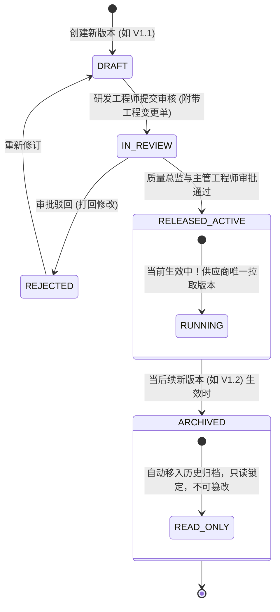

# 11 - 轻量级 BOM 管理与包装出货层级规范 (Lean BOM & Packaging Hierarchy)

---

## 1. 敏捷型 BOM 设计哲学 (Lean & Pragmatic BOM)

用户的核心原则：  
> **“建立完整产品 BOM 列表管理，但不要复杂，以上传的文件为准即可。需要区分包装、说明书、零件、总成，以及完成包装的出货状态、成箱状态、托盘状态。BOM 的版本管理独立，确保上一个版本归档，新版本生效，以此确保供应商生产的唯一性。”**

传统重型 PLM 系统（如 Teamcenter/Windchill）动辄数千个字段与复杂的零件检入检出，严重拖垮初创硬件团队的敏捷度。  
Bravio ERP 采用 **“受控文件核心 + 结构化层级快照”** 的实用主义架构：以经工程审批的受控 Excel/PDF 文件为最终权威真本，并在系统内按清晰的工业分类进行数字化映射。

---

## 2. BOM 四大核心层级分类（Taxonomic Categories）

系统将构成一个最终出货品的所有物料严格归纳为四大类别，确保物料清单结构清晰、职责分明：

```
                              [ Bravio 顶级出货总成 ]
                                         │
        ┌───────────────────┬────────────┴───────┬───────────────────┐
        ▼                   ▼                    ▼                   ▼
┌───────────────┐   ┌───────────────┐   ┌────────────────┐   ┌───────────────┐
│ 1. 总成       │   │ 2. 零件       │   │ 3. 说明书/资料 │   │ 4. 包装材料   │
│ (ASSEMBLY)    │   │ (PART)        │   │ (DOCUMENTATION)│   │ (PACKAGING)   │
├───────────────┤   ├───────────────┤   ├────────────────┤   ├───────────────┤
│• LED发光模组  │   │• 压铸铝散热体 │   │• 多语言说明书  │   │• 吸塑内衬     │
│• 恒流驱动板   │   │• 亚克力透镜   │   │• E-mark认证卡  │   │• 零售彩盒     │
│• 单灯成品总成 │   │• 硅胶防水圈   │   │• 质保承诺书    │   │• 运输外箱     │
│               │   │• 紧固螺钉/线束│   │• 防伪警告标签  │   │• 木质免熏托盘 │
└───────────────┘   └───────────────┘   └────────────────┘   └───────────────┘
```

---

## 3. 三级包装出货状态定义（Packaging & Shipping States）

针对汽车后市场出运形态，BOM 明确定义了从单灯到物流托盘的三级出货形态与包材用量：

### 3.1 状态一：完成包装的出货状态（Finished Boxed Unit / 彩盒零售态）
- **定义**：消费者或维修技师在零售店货架上看到的最小销售单元（彩盒）。
- **BOM 物料组成**：
  - `2 支` 单灯终检总成（强制同 Binning 配对，参见文档 07）。
  - `2 个` 吸塑减震内衬盒。
  - `1 份` 欧标多语言折叠说明书与认证背书卡。
  - `2 包` 工业硅胶干燥剂。
  - `1 个` 覆膜烫金零售彩盒 + 2 张防撕封口胶贴。

### 3.2 状态二：成箱状态（Carton Packed Unit / 运输外箱态）
- **定义**：国内干线运输与海运装箱的二级集装单元。
- **BOM 物料组成**：
  - `20 个` 已完成包装的零售彩盒（即包含 40 支车灯）。
  - `1 个` 5 层高强度瓦楞纸外箱（K=A 强化箱）。
  - `2 条` 封箱工字胶带。
  - `1 张` 箱体外侧综合信息标签贴（包含外箱条码与重量尺寸）。

### 3.3 状态三：托盘状态（Pallet Logistics Unit / 物流托盘态）
- **定义**：整柜海运装船与德国海外仓整进整出的顶级物流搬运单元。
- **BOM 物料组成**：
  - `24 个` 完整运输外箱（共计 480 个彩盒 / 960 支车灯）。
  - `1 个` 标准欧标免熏蒸木托盘（1200mm $\times$ 800mm）。
  - `4 根` 纸质护角（垂直角位加固）。
  - `5 层` PE 工业拉伸防潮缠绕膜。
  - `2 张` 托盘物流追溯大标签（贴于相邻两侧面）。

---

## 4. BOM 版本独立管控与单一生效原则 (Single Source of Truth)

为了确保代工厂供应商在生产中**绝对不可能用错版本**，系统建立严格的“前序版本自动归档、新版本排他生效”机制：



### 4.1 数据模型设计 (`product_boms` & `bom_versions`)

```sql
CREATE TYPE bom_status_enum AS ENUM ('DRAFT', 'IN_REVIEW', 'RELEASED_ACTIVE', 'ARCHIVED');

CREATE TABLE bom_versions (
    id UUID PRIMARY KEY DEFAULT gen_random_uuid(),
    product_id UUID NOT NULL REFERENCES product_masters(id),
    version_tag VARCHAR(20) NOT NULL,        -- 版本标识，如: 'V1.0', 'V1.1', 'V2.0'
    status bom_status_enum DEFAULT 'DRAFT',
    
    -- 受控文件真本存证 (Excel / PDF / STEP)
    source_file_name VARCHAR(255) NOT NULL,
    source_file_url TEXT NOT NULL,
    source_file_sha256 CHAR(64) NOT NULL,   -- 文件哈希验签，杜绝篡改
    
    -- 变更说明与审批人
    change_summary TEXT,                     -- 本次版本变动精要
    approved_by_id UUID,
    approved_at TIMESTAMPTZ,
    effective_from TIMESTAMPTZ,              -- 生效起始时点
    archived_at TIMESTAMPTZ,                 -- 归档废止时点
    
    created_at TIMESTAMPTZ DEFAULT CURRENT_TIMESTAMP,
    created_by_id UUID,
    updated_at TIMESTAMPTZ DEFAULT CURRENT_TIMESTAMP,
    updated_by_id UUID,
    is_deleted BOOLEAN DEFAULT FALSE,
    version_id INT DEFAULT 1,
    CONSTRAINT uq_product_bom_version UNIQUE(product_id, version_tag)
);

-- 结构化 BOM 条目快照表 (轻量数字化，按 4 大类分类)
CREATE TABLE bom_items (
    id UUID PRIMARY KEY DEFAULT gen_random_uuid(),
    bom_version_id UUID NOT NULL REFERENCES bom_versions(id) ON DELETE CASCADE,
    category VARCHAR(20) NOT NULL,           -- 'ASSEMBLY', 'PART', 'MANUAL_DOC', 'PACKAGING'
    item_code VARCHAR(50) NOT NULL,          -- 物料或图号代码
    item_name VARCHAR(150) NOT NULL,         -- 物料名称
    specification TEXT,                      -- 材质规格与型号参数
    qty_per_boxed_unit NUMERIC(10, 4) NOT NULL, -- 单彩盒标称用量
    unit VARCHAR(10) DEFAULT 'PCS',          -- 单位: PCS, SET, KG, G, M
    is_critical_for_cop BOOLEAN DEFAULT FALSE -- 是否属于 KBA 生产一致性审查件
);
```

### 4.2 排他生效事务触发逻辑（Atomic Switch Trigger）
当管理员或质量总监点击 `[ 批准并生效新版本 V1.1 ]` 时，系统在单一数据库事务内完成切换：

```sql
BEGIN;
-- 1. 将该产品原本正处于生效状态的老版本 (V1.0) 自动归档并打上归档时间戳
UPDATE bom_versions
SET 
    status = 'ARCHIVED',
    archived_at = CURRENT_TIMESTAMP
WHERE product_id = :target_product_id AND status = 'RELEASED_ACTIVE';

-- 2. 将当前新版本 (V1.1) 正式置为生效状态
UPDATE bom_versions
SET 
    status = 'RELEASED_ACTIVE',
    effective_from = CURRENT_TIMESTAMP,
    approved_by_id = :current_user_id,
    approved_at = CURRENT_TIMESTAMP
WHERE id = :new_bom_version_id;

-- 3. 同步更新产品主表的当前生效修订版号
UPDATE product_masters
SET current_revision = :new_revision_char
WHERE id = :target_product_id;

COMMIT;
```

该机制从物理层面消除了“供应商同时看到两个版本”的致命风险，让供应商生产界面的拉取结果始终保证**绝对唯一**。
