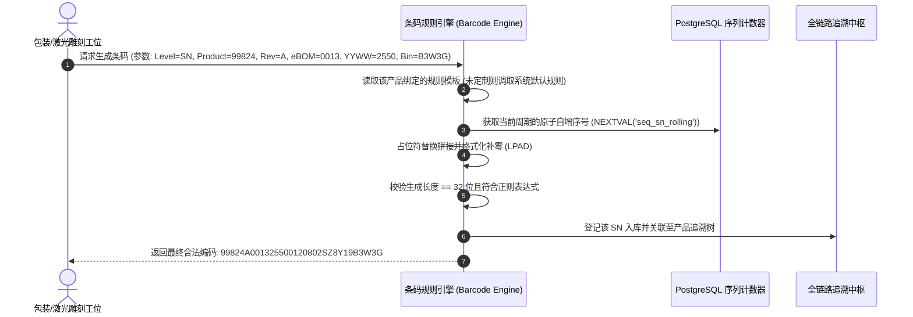

# 12 - 多层级可配置条码与序列号规则引擎 (Configurable Barcode Rules Engine)

---

## 1. 业务愿景与规则引擎定位

用户的核心需求：  
> **“在系统中帮助我创建各层级下的一个默认序列号格式，稍后可以独立修改编码规则，并整合到完整的产品追溯链路中。”**

硬编码的序列号生成逻辑极易成为未来业务扩展的瓶颈（例如：后续某 OEM 客户要求使用定制条码格式，或者出口北美需符合特殊 GS1-128 标准）。  
因此，Bravio ERP 建立了 **“基于占位符标记（Token-Based）的可配置条码规则引擎”**。系统预置默认的工业级四级标准编码，管理员未来可在系统后台可视化界面自由调配参数，无需改动一行底层代码。

---

## 2. 四级包装层级默认编码规范（开箱即用默认模板）

系统根据汽车照明制造与跨国物流行业标准，预置以下四级默认规则：

| 包装层级 (Pack Level) | 默认规则表达式 (Template Expression) | 目标长度 | 示例生成结果 | 规则解析与说明 |
| :--- | :--- | :---: | :--- | :--- |
| **Level 1: 单品激光码 (SN)** | `{BRAVIO_ID}{REV}{EBOM}{YYWW}{SEQ:5}{HW_VER}{LED_PN}{LED_FULL_BIN}` | **32 位** | `99824A001325500120802SZ8Y19B3W3G` | 严格匹配文档 07 激光微距雕刻规范，由零件号、周次、5位流水号及 Binning 档位紧密拼装而成。 |
| **Level 2: 零售彩盒码 (BOX)**| `BOX-{YYYYMMDD}-{SEQ:6}` | 21 位 | `BOX-20261017-000128` | 供应商包装工位双灯配对成功后自动喷印于彩盒封口侧，支持按日递增流水号。 |
| **Level 3: 外箱运输码 (CTN)**| `CTN-{YYYYMMDD}-{SEQ:5}` | 20 位 | `CTN-20261017-00024` | 运输外箱包装完成后喷印的条码，包含装箱年月日及 5 位箱流水号。 |
| **Level 4: 物流托盘码 (PLT)**| `PLT-{YYYYMMDD}-{SEQ:4}` | 19 位 | `PLT-20261017-0003` | 欧洲海运集装与德国海外仓整盘接收入库的一维/二维综合物流大标。 |

---

## 3. 动态占位符标记字典 (Dynamic Token Dictionary)

规则引擎支持解析以下上下文动态变量（Tokens）：

```
┌────────────────────────────────────────────────────────────────────────┐
│                      系统动态占位符标记 (Tokens)                        │
├───────────────────┬────────────────────────────────────────────────────┤
│ 基础产品参数      │ {BRAVIO_ID} (5位料号)  {REV} (1位版次)            │
│                   │ {EBOM} (4位eBOM码)    {HW_VER} (2位硬件版本)       │
├───────────────────┼────────────────────────────────────────────────────┤
│ 光电分档参数      │ {LED_PN} (6位芯片号)   {LED_FULL_BIN} (5位色温/流明)│
│                   │ {LED_COLOR} (2位色温)  {LED_FLUX} (2位光通量)      │
├───────────────────┼────────────────────────────────────────────────────┤
│ 日期与时间基准    │ {YYWW} (2位年+2位周次) {YYYYMMDD} (8位完整年月日)  │
│                   │ {YYMMDD} (6位短日期)   {JULIAN} (3位儒略日)        │
├───────────────────┼────────────────────────────────────────────────────┤
│ 序列号与防伪特征  │ {SEQ:n} (n位自动补零递增流水号，支持按天/周/年重置) │
│                   │ {RANDOM:n} (n位高熵大写字母数字随机字符，用于防伪) │
│                   │ {SUPPLIER_CODE} (代工厂代码)                       │
└───────────────────┴────────────────────────────────────────────────────┘
```

---

## 4. 数据库实体与规则管理模型 (`barcode_rule_templates`)

```sql
CREATE TYPE barcode_target_level_enum AS ENUM ('SN', 'BOX', 'CARTON', 'PALLET');

CREATE TABLE barcode_rule_templates (
    id UUID PRIMARY KEY DEFAULT gen_random_uuid(),
    rule_name VARCHAR(100) NOT NULL,            -- 规则名称，如: "标准32位车灯单品激光码规则"
    target_level barcode_target_level_enum NOT NULL, -- 适用层级
    template_expression VARCHAR(255) NOT NULL,   -- 核心模板表达式，如: "{BRAVIO_ID}{REV}{EBOM}..."
    fixed_length INT,                            -- 期望总长度校验 (若为 32 则强校验生成长度必须为 32)
    regex_validation_pattern VARCHAR(255),       -- 生成后或扫码时的二次正则核对格式
    
    -- 序列号递增与重置策略
    seq_counter_name VARCHAR(50) NOT NULL,       -- PostgreSQL 关联序列名
    reset_cycle VARCHAR(20) DEFAULT 'WEEKLY',    -- 'NEVER', 'YEARLY', 'WEEKLY', 'DAILY'
    
    -- 版本控制与状态
    is_system_default BOOLEAN DEFAULT FALSE,     -- 是否为系统默认出厂规则
    is_active BOOLEAN DEFAULT TRUE,              -- 是否启用
    description TEXT,
    
    created_at TIMESTAMPTZ DEFAULT CURRENT_TIMESTAMP,
    updated_at TIMESTAMPTZ DEFAULT CURRENT_TIMESTAMP
);

-- 初始化 4 个层级的系统默认规则
INSERT INTO barcode_rule_templates (
    rule_name, target_level, template_expression, fixed_length, regex_validation_pattern, seq_counter_name, reset_cycle, is_system_default
) VALUES 
(
    '标准32位单品激光微距码', 
    'SN', 
    '{BRAVIO_ID}{REV}{EBOM}{YYWW}{SEQ:5}{HW_VER}{LED_PN}{LED_FULL_BIN}', 
    32, 
    '^[0-9]{5}[A-Z][0-9]{8}[0-9]{2}[A-Z0-9]{6}[A-Z0-9]{5}$', 
    'seq_sn_rolling', 
    'WEEKLY', 
    TRUE
),
(
    '标准零售彩盒码 (BOX)', 
    'BOX', 
    'BOX-{YYYYMMDD}-{SEQ:6}', 
    21, 
    '^BOX-[0-9]{8}-[0-9]{6}$', 
    'seq_box_rolling', 
    'DAILY', 
    TRUE
),
(
    '标准运输外箱码 (CARTON)', 
    'CARTON', 
    'CTN-{YYYYMMDD}-{SEQ:5}', 
    20, 
    '^CTN-[0-9]{8}-[0-9]{5}$', 
    'seq_ctn_rolling', 
    'DAILY', 
    TRUE
),
(
    '标准物流托盘码 (PALLET)', 
    'PALLET', 
    'PLT-{YYYYMMDD}-{SEQ:4}', 
    19, 
    '^PLT-[0-9]{8}-[0-9]{4}$', 
    'seq_plt_rolling', 
    'DAILY', 
    TRUE
);
```

---

## 5. 规则解析执行流与追溯兼容性保障 (Execution Pipeline)



### 追溯兼容性铁律（Backward Compatibility）
- 如果管理员在 2027 年为新产品修改了彩盒编码规则（例如改为 `BOX-27-XXXXXX`），**历史已出厂的旧条码解析器严禁受影响**。
- 系统在每个包装实体中记录其**创建时所采用的规则模板 ID 与版本**，确保逆向溯源时永远使用发码当日的标准逆向解码，保障数据链条的百年一致性。

---

## 6. 工业硬件打印中枢与标签模板管理 (Industrial Print Engine)

### 6.1 标签模板数据模型 (`label_templates`)
为了无缝驱动车间主流工业条码打印机（Zebra / TSC / Postek），系统建立标准化模板库：

```sql
CREATE TABLE label_templates (
    id UUID PRIMARY KEY DEFAULT gen_random_uuid(),
    template_code VARCHAR(50) NOT NULL UNIQUE,       -- 如: "TPL_BOX_RETAIL_100X60"
    template_name VARCHAR(100) NOT NULL,
    target_level barcode_target_level_enum NOT NULL, -- SN, BOX, CARTON, PALLET, SAMPLE
    printer_driver_type VARCHAR(20) DEFAULT 'ZPL',   -- 'ZPL' (Zebra), 'TSPL' (TSC), 'PDF'
    zpl_raw_code TEXT NOT NULL,                      -- 带有占位符的原始工业指令集
    dpi INT DEFAULT 300,                             -- 打印精度 (300 DPI 适合高密微距码)
    is_active BOOLEAN DEFAULT TRUE,
    created_at TIMESTAMPTZ DEFAULT CURRENT_TIMESTAMP,
    updated_at TIMESTAMPTZ DEFAULT CURRENT_TIMESTAMP
);
```

### 6.2 零弹窗工位本地打印代理 (Print Proxy Agent)
- 在包装工位或质检测试台运行轻量级本地代理程序（基于 WebSocket 监听）；
- 当操作员完成双灯配对或外箱装箱时，FastAPI 后端在事务提交成功的一瞬间，直接通过 WebSocket 向工位打印代理推送经渲染的 ZPL 字节指令流；
- 打印机即刻出纸喷码，全程**零弹窗、零鼠标点击、响应耗时 $< 100\text{ms}$**，完美支撑工业高节拍作业。

---

## 7. 全局业务单据流水号引擎 (Document Sequence Engine)

针对系统内非条码类的业务单据（工单 `PO-`、质检单 `QC-`、失效事件 `INC-`、工程变更 `EC-`、8D 报告 `8D-`、库存事务 `TX-`）：

```sql
CREATE TABLE sys_document_sequences (
    seq_code VARCHAR(32) PRIMARY KEY,                -- 单据类型代码 (如: "PO", "QC", "TX")
    prefix VARCHAR(10) NOT NULL,                     -- 前缀 (如: "PO-")
    date_format VARCHAR(10) DEFAULT 'YYYY',          -- 'YYYY', 'YYYYMM', 'YYYYMMDD'
    current_number BIGINT NOT NULL DEFAULT 0,        -- 当前自增流水
    number_length INT DEFAULT 4,                     -- 补零位数 (如: 4 位 -> 0001)
    reset_cycle VARCHAR(10) DEFAULT 'YEARLY',        -- 'YEARLY', 'MONTHLY', 'DAILY', 'NEVER'
    last_reset_date DATE DEFAULT CURRENT_DATE
);
```
通过 Redis 原子自增保障高并发单据提交时绝对不重号、不跳号，并保留严格的单据生命周期防伪审计。

