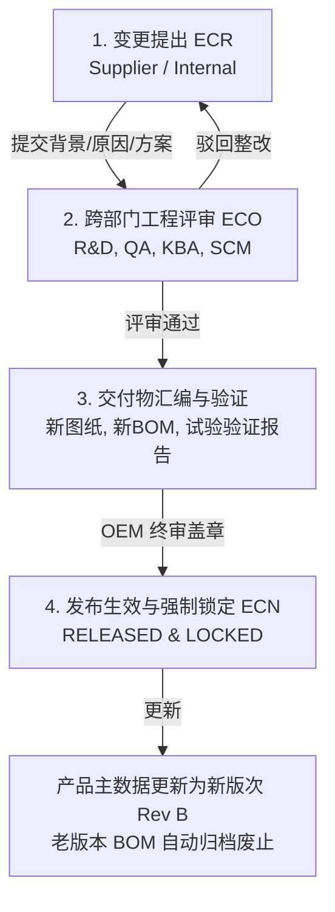

# 13 - 汽车级工程设计变更管理规范 (Engineering Change Management - PLM Standard)

---

## 1. 业务目标与汽车工业 PLM 标准 (ECR / ECO / ECN)

用户的核心需求：  
> **“关于设计变更，供应商可以提交设变申请，OEM 端批准，按照专业汽车工业 PLM 方式管理。图纸、BOM、对应的测试数据结论均能够上传、发布、锁定。”**

在汽车照明与高端制造领域，擅自更改元器件（例如：将电容由日系改为国产，或微调铝壳散热鳍片厚度）可能直接导致 ECE 法规配光不达标、EMC 电磁兼容超标，甚至直接引发德国 KBA 撤销型式认证资质。  
Bravio ERP 严格遵循国际汽车标准体系（IATF 16949 与 VDA 规范），构建闭环的 **ECR（变更申请） $\to$ ECO（变更令评审） $\to$ ECN（变更发布与存证锁定）** 全流程管理中枢。

---

## 2. 变更四步闭环生命周期 (Engineering Change Lifecycle)



---

## 3. 设变核心存证证据链（四大要素上传、发布与锁定）

任何一次工程变更在被批准前，系统强制要求在附件包中集齐**四大合规技术要素**：

| 证据要素 | 文件类型与格式 | 核心核查指标 | 系统的合规管控 |
| :--- | :--- | :--- | :--- |
| **1. 受控工程图纸 (Drawings)** | 2D 尺寸图 (PDF) + 3D 模型 (STEP) | 图框具备变更履历栏（Revision Block），明确标出云线圈注（Delta Cloud）。 | 经审核后自动打上水印与 SHA-256 散列并锁定为只读。 |
| **2. 关联新版 BOM (New BOM)** | 结构化 BOM 清单 (Excel / CSV) | 标明本次被替换物料的旧料号与新料号，核查单机用量及替代关系。 | 自动绑定到 [11号文档](file:///c:/Users/zhang/Documents/Python/bravio-erp/docs/11_LEAN_BOM_AND_PACKAGING_HIERARCHY.md) 的 `bom_versions`，准备生效。 |
| **3. 试验验证数据与结论 (DVP&R)**| 配光测试、EMC、高低温冲击实验报告 (PDF) | 必须包含测试设备编号、试验日期、测试曲线图及明确的“合格 (PASS)”结论。 | 质检总监签署电子意见，对技术结论终身负责。 |
| **4. KBA 型式认证符合性评价 (CoP Assessment)** | 法规影响评估分析单 (PDF) | 结论必须明确勾选：<br>① **无需报备**（属于非法规关键尺寸微调）；<br>② **需通知发证机构 (Notification)**；<br>③ **需重新送检德国实验室 (Extension Test)**。 | KBA 合规官一票否决权，严防违规生产。 |

---

## 4. 数据库实体模型设计 (`engineering_changes` & `ec_evidence_files`)

```sql
CREATE TYPE ec_type_enum AS ENUM ('SUPPLIER_INITIATED', 'OEM_INITIATED');
CREATE TYPE ec_status_enum AS ENUM (
    'DRAFT',            -- 草稿
    'ECR_SUBMITTED',    -- 变更申请已提交
    'ECO_REVIEWING',    -- 跨部门评审中
    'VERIFICATION_PASS',-- 试验验证结论通过
    'ECN_RELEASED',     -- 正式发布生效并全面锁定 (LOCKED)
    'REJECTED'          -- 驳回中止
);

CREATE TABLE engineering_changes (
    id UUID PRIMARY KEY DEFAULT gen_random_uuid(),
    ec_no VARCHAR(32) NOT NULL UNIQUE,       -- 设变编号，如: "EC-2026-0008"
    product_id UUID NOT NULL REFERENCES product_masters(id),
    change_type ec_type_enum NOT NULL,       -- 供应商发起 或 OEM 内部发起
    initiator_partner_id VARCHAR(32) REFERENCES partners(partner_id),
    
    -- 变更版本跨度
    from_revision CHAR(1) NOT NULL,          -- 变更前版次 (如: A)
    to_revision CHAR(1) NOT NULL,            -- 变更后目标版次 (如: B)
    
    -- 变更描述与原因
    change_title VARCHAR(150) NOT NULL,      -- 变更主题 (如: "铝合金散热体结构开槽优化以提升热对流")
    change_reason_category VARCHAR(50) NOT NULL, -- 'COST_DOWN', 'QUALITY_IMPROVEMENT', 'SUPPLIER_TRANSFER', 'REGULATION'
    detailed_description TEXT NOT NULL,      -- 详细技术描述
    
    -- KBA 认证影响分析 (CoP Assessment)
    kba_impact_assessment VARCHAR(50) NOT NULL, -- 'NO_IMPACT', 'EXTENSION_REQUIRED', 'NOTIFICATION_ONLY'
    kba_officer_sign_id UUID,
    
    -- 流程状态与审批
    status ec_status_enum DEFAULT 'DRAFT',
    target_effective_batch VARCHAR(32),      -- 计划生效生产周次或工单号 (如: "YYWW >= 2610")
    old_inventory_disposition VARCHAR(50),   -- 在库老料处理方案: 'USE_UP' (自然消耗), 'SCRAP' (强制报废), 'REWORK' (返工)
    
    -- 发布与锁定戳
    released_by_id UUID,
    released_at TIMESTAMPTZ,
    is_locked BOOLEAN DEFAULT FALSE,         -- 核心标志: 一旦 ECN 发布，整包资料永久只读锁定
    
    created_at TIMESTAMPTZ DEFAULT CURRENT_TIMESTAMP,
    created_by_id UUID,
    updated_at TIMESTAMPTZ DEFAULT CURRENT_TIMESTAMP,
    updated_by_id UUID,
    is_deleted BOOLEAN DEFAULT FALSE,
    version_id INT DEFAULT 1
);

-- 设变证明材料文件存证表 (图纸/BOM/测试报告)
CREATE TABLE ec_evidence_files (
    id UUID PRIMARY KEY DEFAULT gen_random_uuid(),
    ec_id UUID NOT NULL REFERENCES engineering_changes(id) ON DELETE CASCADE,
    file_category VARCHAR(30) NOT NULL,      -- 'DRAWING_2D', 'MODEL_3D', 'BOM_SHEET', 'TEST_REPORT', 'KBA_OPINION'
    file_title VARCHAR(150) NOT NULL,
    file_url TEXT NOT NULL,
    file_sha256 CHAR(64) NOT NULL,          -- SHA-256 证据散列防伪
    file_size_bytes BIGINT NOT NULL,
    uploader_id VARCHAR(50) NOT NULL,
    uploaded_at TIMESTAMPTZ DEFAULT CURRENT_TIMESTAMP
);
```

---

## 5. 设变生效原子触发与版本继承执行逻辑 (Release & Lock Pipeline)

当质量总监完成最终电子签署并点击 `[ 发布并锁定 ECN (Release & Lock) ]` 时，系统触发底层管道：

```sql
BEGIN;

-- 1. 将设变单据状态置为 ECN_RELEASED 并开启物理锁定
UPDATE engineering_changes
SET 
    status = 'ECN_RELEASED',
    is_locked = TRUE,
    released_by_id = :current_user_id,
    released_at = CURRENT_TIMESTAMP
WHERE id = :target_ec_id;

-- 2. 产品主数据版次递增 (例如从 A 升级为 B)
UPDATE product_masters
SET 
    current_revision = :to_revision,
    updated_at = CURRENT_TIMESTAMP
WHERE id = :product_id;

-- 3. 关联的已审核新版 BOM 正式激活，老版 BOM 移入历史归档 (调用文档 11 的切换逻辑)
UPDATE bom_versions SET status = 'ARCHIVED', archived_at = CURRENT_TIMESTAMP 
WHERE product_id = :product_id AND status = 'RELEASED_ACTIVE';

UPDATE bom_versions SET status = 'RELEASED_ACTIVE', effective_from = CURRENT_TIMESTAMP 
WHERE id = :new_bom_version_id;

-- 4. 自动在 Chatter 产生审计动态，并向所有关联代工厂及质检专员发送 ECN 强制通知令
INSERT INTO audit_trail_logs (
    target_module, target_table, target_id, action_type, changes_diff, reason, is_compliance_critical
) VALUES (
    'engineering_change', 'engineering_changes', :target_ec_id, 'ECN_RELEASED_AND_LOCKED',
    jsonb_build_object('ec_no', :ec_no, 'from_rev', :from_rev, 'to_rev', :to_rev),
    '完成工程变更发布与新图纸新BOM法定锁定。', TRUE
);

COMMIT;
```

### 业务保障价值
1. **防止私自变更**：供应商无法私自替换供应商或调整工艺，任何小改动必须有据可查；
2. **KBA 审查零风险**：外部审核员现场核查时，可当场调出该产品从 Rev A 到 Rev B 每次变更的测试报告与批准签署时间轴，展示世界一流的工程变更控制水平。
