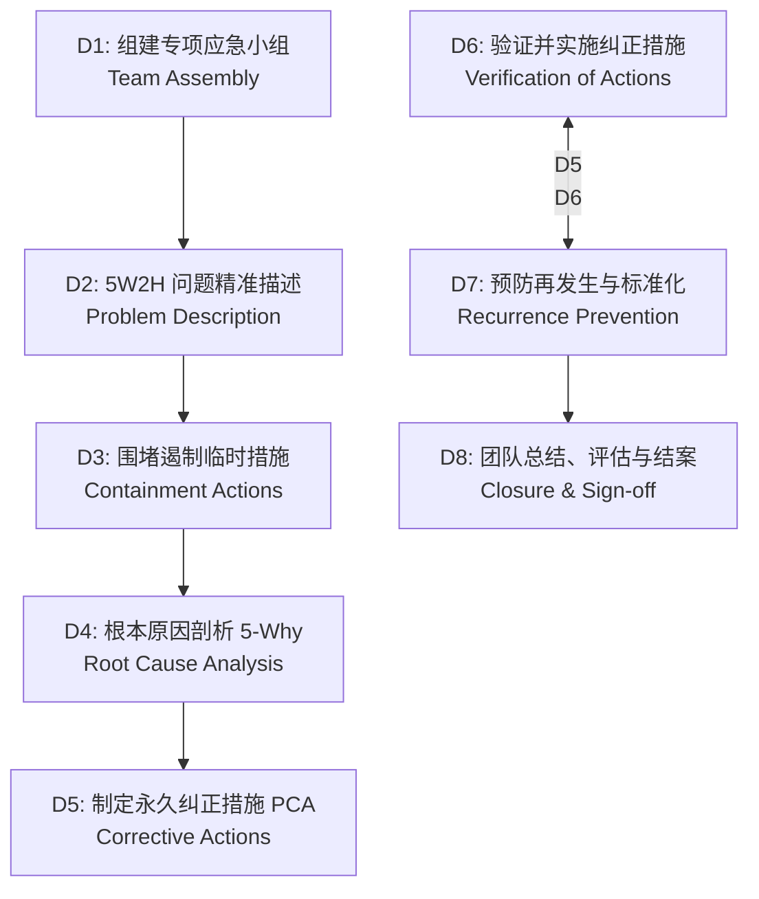

# 14 - 质量管理体系、全流程质检与 8D 失效事件管理 (QMS & Bravio Incident 8D)

---

## 1. 业务目标与 ISO 9001 / KBA CoP 合规技术基准

本模块为 Bravio ERP 质量中枢，旨在全面贯彻 **ISO 9001:2015**（第 8.6 条“产品和服务放行”、第 8.7 条“不合格输出控制”、第 10.2 条“不合格和纠正措施”）与 **德国 KBA 生产一致性（CoP - Conformity of Production）** 核心审查要求：

```
                              [ Bravio 质量中枢 (QMS Core) ]
                                             │
        ┌────────────────────────────────────┼────────────────────────────────────┐
        ▼                                    ▼                                    ▼
┌───────────────────────────────┐  ┌───────────────────────────────┐  ┌───────────────────────────────┐
│ 1. 全流程批次质检档案库       │  │ 2. 产品级全局质量看板 (台账) │  │ 3. Bravio 失效事件与 8D 闭环  │
├───────────────────────────────┤  ├───────────────────────────────┤  ├───────────────────────────────┤
│• 供应商出厂终检 (FQC / OQC)   │  │• APQP G阀研发验证报告汇总     │  │• 单品 SN 失效现场快速建单     │
│• 德国海外仓来料质检 (IQC)     │  │• 制造端出厂合格证 (COA) 穿透  │  │• 经典汽车工业 8D 报告标准    │
│• 过程巡检 (IPQC) 关键特性     │  │• 德国仓入库抽检明细聚合       │  │• 供应商整改流转与免责归档     │
│• KBA 配光与电气一致性验证     │  │• 批次合格率与 CoP 预警指标    │  │• 纠正防范措施 (CAPA) 闭环    │
└───────────────────────────────┘  └───────────────────────────────┘  └───────────────────────────────┘
```

---

## 2. 全流程检验数据模型 (Inspection Records Architecture)

质量模块将“供应商生产端检测”与“OEM 仓库端检测”统一纳入数字化模型管控，杜绝纸质报告丢失或篡改隐患：

-- 0. 生产工单主表 (全系统制造与质检溯源基准)
CREATE TYPE production_order_status_enum AS ENUM (
    'PLANNED', 'RELEASED_TO_SUPPLIER', 'IN_PRODUCTION', 'FQC_COMPLETED', 'CLOSED', 'CANCELLED'
);

CREATE TABLE production_orders (
    order_no VARCHAR(32) PRIMARY KEY,                 -- 工单号，例: "PO-2026-1008"
    product_id UUID NOT NULL REFERENCES product_masters(id),
    supplier_id VARCHAR(32) NOT NULL REFERENCES partners(partner_id),
    bom_version_id UUID NOT NULL REFERENCES bom_versions(id),
    target_qty INT NOT NULL CHECK (target_qty > 0),
    produced_qty INT NOT NULL DEFAULT 0,
    scrapped_qty INT NOT NULL DEFAULT 0,
    batch_yyww CHAR(4) NOT NULL,                      -- 锁定年份周次 (如: 2550)
    hw_revision CHAR(1) NOT NULL,                     -- 锁定硬件版次 (如: A)
    ebom_code CHAR(4) NOT NULL,                       -- 锁定供应商 eBOM 代码
    hw_version CHAR(2) NOT NULL,
    allowed_led_bins VARCHAR(10)[] NOT NULL,
    status production_order_status_enum DEFAULT 'PLANNED',
    planned_start_date DATE NOT NULL,
    planned_end_date DATE NOT NULL,
    actual_completed_at TIMESTAMPTZ,
    created_at TIMESTAMPTZ DEFAULT CURRENT_TIMESTAMP,
    created_by_id UUID,
    updated_at TIMESTAMPTZ DEFAULT CURRENT_TIMESTAMP,
    is_deleted BOOLEAN DEFAULT FALSE,
    version_id INT DEFAULT 1
);

-- 1. 质检记录主表
CREATE TYPE inspection_type_enum AS ENUM (
    'SUPPLIER_OQC_FQC',     -- 供应商出厂终检 (Outgoing/Final Quality Control)
    'WAREHOUSE_IQC',        -- OEM 德国仓来料质检 (Incoming Quality Control)
    'IN_PROCESS_IPQC',      -- 生产过程关键工序巡检
    'KBA_COP_AUDIT_TEST'    -- 德国实验室 KBA 生产一致性年度抽查复测
);

CREATE TYPE inspection_result_enum AS ENUM ('PASS', 'FAIL', 'CONCESSION_PASS'); -- 合格、不合格、特采让步


CREATE TABLE quality_inspection_records (
    id UUID PRIMARY KEY DEFAULT gen_random_uuid(),
    inspection_no VARCHAR(32) NOT NULL UNIQUE, -- 检验单号，如: "QC-20261017-001"
    inspection_type inspection_type_enum NOT NULL,
    
    -- 关联产品、订单与批次
    product_id UUID NOT NULL REFERENCES product_masters(id),
    order_no VARCHAR(32) REFERENCES production_orders(order_no),
    batch_yyww CHAR(4) NOT NULL,               -- 生产周次 (如: 2550)
    target_pack_id VARCHAR(40),                -- 关联抽检的托盘/外箱/彩盒ID
    
    -- 检验执行主体
    inspector_id VARCHAR(50) NOT NULL,         -- 质检员用户名/代号
    inspector_name VARCHAR(100) NOT NULL,
    inspector_company_type VARCHAR(20) NOT NULL,-- 'SUPPLIER' 或 'BRAVIO_OEM'
    inspection_date DATE NOT NULL DEFAULT CURRENT_DATE,
    
    -- 抽样参数与测试指标 (遵循 MIL-STD-105E / ISO 2859-1 抽样标准)
    total_batch_qty INT NOT NULL,              -- 报检批次总数量
    sample_size INT NOT NULL,                  -- 实际抽样件数
    defect_qty INT DEFAULT 0,                  -- 发现不合格品数
    aql_standard VARCHAR(20) DEFAULT 'AQL 0.65',-- AQL 允收质量限水准
    
    -- 关键特性量测明细 (配光、光通量、电压、高低温、EMC)
    test_measurements_json JSONB NOT NULL,     -- 关键检测数据点实测数组
    result inspection_result_enum NOT NULL,
    kba_cop_conformity BOOLEAN DEFAULT TRUE,   -- 是否符合 KBA 生产一致性标准
    
    -- 受控原始检验报告扫描件 (COA / Test Sheet)
    report_file_url TEXT NOT NULL,
    report_file_sha256 CHAR(64) NOT NULL,      -- 报告数字指纹
    
    remarks TEXT,
    created_at TIMESTAMPTZ DEFAULT CURRENT_TIMESTAMP
);

CREATE INDEX idx_qms_inspection_prod ON quality_inspection_records(product_id);
CREATE INDEX idx_qms_inspection_yyww ON quality_inspection_records(batch_yyww);
CREATE INDEX idx_qms_inspection_type ON quality_inspection_records(inspection_type);

-- 2. 特采让步放行申请与双签受控流向表 (Concession & Waiver)
CREATE TABLE quality_concessions (
    id UUID PRIMARY KEY DEFAULT gen_random_uuid(),
    concession_no VARCHAR(32) NOT NULL UNIQUE,       -- 特采单号，例: "DEV-2026-0005"
    inspection_id UUID NOT NULL REFERENCES quality_inspection_records(id),
    product_id UUID NOT NULL REFERENCES product_masters(id),
    batch_yyww CHAR(4) NOT NULL,
    max_concession_qty INT NOT NULL,                 -- 允许让步放行的最大件数
    deviation_description TEXT NOT NULL,             -- 偏离指标说明 (如散热壳轻微外观划痕)
    risk_assessment_optical TEXT NOT NULL,           -- 光学与法规影响评估 (确认无影响)
    
    -- 双重审批电子签章 (研发总监 + 质量总监)
    rd_director_id UUID NOT NULL,
    rd_signed_at TIMESTAMPTZ NOT NULL,
    qa_director_id UUID NOT NULL,
    qa_signed_at TIMESTAMPTZ NOT NULL,
    
    -- 受控销售流向限制
    prohibit_oem_shipment BOOLEAN DEFAULT TRUE,      -- 核心拦截: 严禁发往 OEM 主机厂
    allowed_customer_types VARCHAR(30)[] DEFAULT '{"B2B_DISTRIBUTOR"}', -- 仅允许售后分销
    created_at TIMESTAMPTZ DEFAULT CURRENT_TIMESTAMP
);
```

---


## 3. 产品级全局质量看板（台账）规范 (Unified Quality Cockpit)

在 Odoo 风格的产品详情页中，质量模块挂载专用的 **“全局质量驾驶舱 (Quality Cockpit)”**，支持质保总监与外部 KBA 审核员一键穿透调阅：

```
┌─────────────────────────────────────────────────────────────────────────────────┐
│ 🚗 产品质量驾驶舱: [ 99824 ] LED Matrix Headlight Gen 2      [ 认证: E1-149R ]  │
├─────────────────────────────────────────────────────────────────────────────────┤
│ [ 研发 APQP 验证 ] │ [ 生产出厂终检 FQC ] │ [ 德国仓入库 IQC ] │ [ 8D 失效与客诉 ] │
├─────────────────────────────────────────────────────────────────────────────────┤
│ 1. 研发阶段门验证报告总表 (APQP Gates)                                          │
│    • Gate 2 (A样): 配光概念初测报告 (PASS)               [ 📄 预览 PDF (验签) ] │
│    • Gate 3 (B样): DVP&R 高低温/振动综合试验报告 (PASS)    [ 📄 预览 PDF (验签) ] │
│    • Gate 4 (PPAP): PSW 零件提交保证书与全尺寸报告 (PASS)  [ 📄 预览 PDF (验签) ] │
├─────────────────────────────────────────────────────────────────────────────────┤
│ 2. 批次出厂与入库比对台账 (FQC vs IQC 对账)                                     │
│    • 批次 2550: 供应商 FQC 抽样 32 支 (合格率 100%)  <-> 德国 IQC 抽检 5 盒 (合格)│
│    • 批次 2549: 供应商 FQC 抽样 32 支 (合格率 100%)  <-> 德国 IQC 抽检 5 盒 (合格)│
│    • 批次 2548: 供应商 FQC (特采让步)                <-> 德国 IQC 重点监控通过   │
├─────────────────────────────────────────────────────────────────────────────────┤
│ 3. 质量指标 KPI 概览 (CoP Metrics)                                             │
│    • 累计交付良品率: 99.82%    • 批次 PPM: 180    • 未结案 8D 单据: 0 项         │
└─────────────────────────────────────────────────────────────────────────────────┘
```

---

## 4. Bravio 失效事件与汽车工业 8D 报告系统 (Incident & 8D Management)

### 4.1 业务背景
当售后 RMA、德国仓 IQC 抽检或分销商退运发现异常时，质检工程师进入 **Bravio Incidence Management** 专用页面快速登记失效事件，并按国际汽车标准生成 **8D 结构化调查报告**。

### 4.2 汽车 8D 结构化步骤规范（D1 到 D8）



| 步骤阶段 | 核心任务与录入规范 | 是否强制供应商参与 |
| :--- | :--- | :---: |
| **D1: 组建团队** | 指定 Bravio 责任工程师、供应商现场代表及质量合规官。 | 是 |
| **D2: 问题描述** | 录入故障件 **32 位单品 SN 码**、生产周次、失效模式（如：透镜内侧起雾、发光芯片色漂、驱动板电容击穿）、失效率。 | 是 |
| **D3: 围堵措施** | **24 小时内完成**：阻断在途批次入库、隔离德国仓及供应商在库品、标记待检散件。 | 是 |
| **D4: 根本原因** | 运用 **5-Why 分析法** 与鱼骨图，深入制造人机料法环（如：回流焊温区传感器漂移导致虚焊）。 | 是 |
| **D5: 纠正措施** | 制定永久性工艺或设计改进方案（例如：加固结构胶注胶道、更新驱动程序过压保护门限）。 | 是 |
| **D6: 实施验证** | 制造 30 支验证样件进行 500 小时加速老化试验，上传验证通过报告。 | 是 |
| **D7: 预防再发生**| 同步更新作业指导书（SOP）、过程失效模式分析（PFMEA）与控制计划（CP）。 | 是 |
| **D8: 结案评估** | OEM 质量总监复核整改效果，签署闭环意见，将事件沉淀入企业质量经验库。 | 是 |

### 4.3 供应商协同与“免整改选项”处理逻辑
系统支持高度灵活的整改决策流：
1. **选项 A：发回供应商要求整改（Supplier CAPA Required）**：
   - 系统将 8D 报告派发至对应供应商门户，设定 D3 围堵（24h 限期）与 D8 结案（14 天限期）倒计时警报。
   - 供应商在线提交整改方案，由 OEM 验收官逐项核准。
2. **选项 B：免整改归档（No Corrective Action Required）**：
   - 经鉴定属于：**用户暴力安装撞击损坏**、**改装大功率电瓶击穿**、或**道路外物石击**等非制造设计原因。
   - 勾选 `supplier_action_required = FALSE`，免除供应商责任，直接出具责任免除说明并闭环归档，记录入退运财务结算台账。

---

## 5. 数据库模型设计 (`quality_incidents` & `quality_eight_d_reports`)

```sql
CREATE TYPE incident_source_enum AS ENUM ('CUSTOMER_RMA', 'WAREHOUSE_IQC_FAIL', 'SUPPLIER_SELF_REPORT', 'MARKET_RETURN');
CREATE TYPE eight_d_step_enum AS ENUM ('D1_TEAM', 'D2_DESC', 'D3_CONTAIN', 'D4_CAUSE', 'D5_PCA', 'D6_VALIDATE', 'D7_PREVENT', 'D8_CLOSED');

-- 失效事件主表 (Incidence Management)
CREATE TABLE quality_incidents (
    id UUID PRIMARY KEY DEFAULT gen_random_uuid(),
    incident_no VARCHAR(32) NOT NULL UNIQUE,   -- 事件编号，如: "INC-2026-0042"
    source incident_source_enum NOT NULL,
    sn_code CHAR(32) REFERENCES product_items(sn_code), -- 关联故障件单品码 (如有)
    product_id UUID NOT NULL REFERENCES product_masters(id),
    supplier_id VARCHAR(32) REFERENCES partners(partner_id),
    batch_yyww CHAR(4),
    
    -- 失效现象描述与现场照片
    failure_symptom_category VARCHAR(50) NOT NULL, -- 'OPTICAL_COLOR_SHIFT', 'BURNOUT', 'WATER_LEAK', 'MECHANICAL'
    problem_title VARCHAR(150) NOT NULL,
    detailed_description TEXT NOT NULL,
    evidence_photo_urls JSONB DEFAULT '[]',
    
    -- 严重度评估
    severity_level VARCHAR(20) DEFAULT 'MAJOR', -- 'CRITICAL' (涉及安全/KBA), 'MAJOR', 'MINOR'
    is_kba_cop_impact BOOLEAN DEFAULT FALSE,    -- 是否触发 KBA 生产一致性事故调查
    
    created_at TIMESTAMPTZ DEFAULT CURRENT_TIMESTAMP,
    created_by_id UUID
);

-- 结构化 8D 报告表
CREATE TABLE quality_eight_d_reports (
    id UUID PRIMARY KEY DEFAULT gen_random_uuid(),
    incident_id UUID NOT NULL UNIQUE REFERENCES quality_incidents(id) ON DELETE CASCADE,
    report_no VARCHAR(32) NOT NULL UNIQUE,     -- 8D 编号，如: "8D-2026-0042"
    current_step eight_d_step_enum DEFAULT 'D1_TEAM',
    
    -- 是否要求供应商整改
    supplier_action_required BOOLEAN DEFAULT TRUE,
    no_action_justification TEXT,              -- 免除整改的具体技术依据 (若免除则必填)
    
    -- 8D 各阶段核心内容 (支持 Markdown 与结构化存储)
    d1_team_members JSONB,                    -- 小组成员名单与职责
    d2_problem_5w2h JSONB,                    -- 5W2H 现象定义
    d3_containment_action TEXT,               -- 应急围堵方案与在途品处理
    d4_root_cause_5why TEXT,                  -- 根本原因推导与失效机理
    d5_corrective_action TEXT,                -- 永久纠正措施 (PCA)
    d6_validation_evidence TEXT,              -- 验证数据与样件测试报告
    d7_preventive_action TEXT,                -- SOP/PFMEA 更新标准
    d8_closure_summary TEXT,                  -- 结案陈词
    
    -- 时效与审批
    target_close_date DATE,
    actual_closed_at TIMESTAMPTZ,
    approved_by_id UUID,
    status VARCHAR(20) DEFAULT 'OPEN'          -- 'OPEN', 'PENDING_OEM_AUDIT', 'CLOSED', 'REJECTED'
);
```
