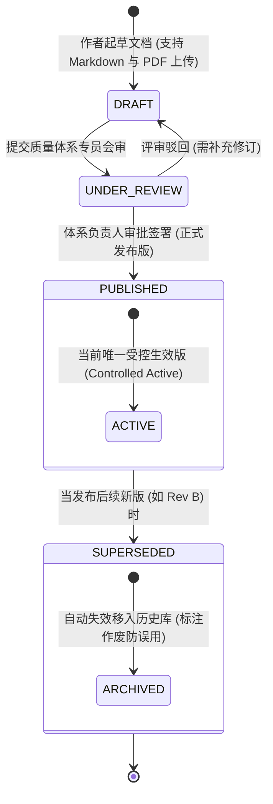

# 15 - 全局受控知识库与文档管理系统 (Global Controlled Wiki & DMS)

---

## 1. 业务目标与 ISO 9001 成文信息合规标准

根据 **ISO 9001:2015 第 7.5 条（成文信息 - Documented Information）** 及德国 KBA 质量管理手册的法定要求，制造企业必须建立严格受控的内部流程管理与技术文件分发体系：
1. **防止非受控传播**：杜绝非受控的草稿或已废止过期的工艺标准流入生产车间与供应商代工厂。
2. **细粒度权限隔离**：公司流程制度、技术研发标准、供应商作业规范按用户组（角色/组织类型）实施严格授权，供应商仅允许调阅与其生产、装配、检验相关的受控资料。
3. **防泄密安全存证**：在线预览与附件调阅强制加注**动态数字安全水印（打印即作废）**，访问行为计入系统审计日志。

---

## 2. 受控文件四层金字塔架构 (Document Hierarchy)

全局通用 Wiki 模组将企业文件按国际质量体系分为四大层级与专门的外部协同通道：

```
                              ┌───────────────────────────────┐
                              │    Level 1: 质量手册 (QM)     │ (企业质量方针、组织纲领、KBA声明)
                              ├───────────────────────────────┤
                              │   Level 2: 体系程序文件 (SOP) │ (跨部门管理流程、设变程序、CAPA程序)
                              ├───────────────────────────────┤
                              │  Level 3: 作业指导书 (WI/SOP) │ (各工位操作规程、光电检验标准)
                              ├───────────────────────────────┤
                              │  Level 4: 表单、记录与报告模板│ (出厂检验单模板、8D报告模板)
                              └───────────────┬───────────────┘
                                              │ 分组受控分发
                                              ▼
                    ┌───────────────────────────────────────────────────┐
                    │      供应商专属技术通道 (Supplier Portal Access)   │
                    │  • 供应商质量手册 (SQM)                           │
                    │  • 产品设计规范与关键公差要求 (GD&T)              │
                    │  • 车间组装工艺标准与防静电规范 (ESD/SOP)          │
                    │  • 32位激光微距刻蚀与四级条码贴标规范              │
                    └───────────────────────────────────────────────────┘
```

---

## 3. 分组权限隔离与可见性矩阵 (Access Control Matrix)

系统依据用户的 **公司身份（内部 / 外部供应商 / 分销商 / 审核员）** 与所属角色组实施动态数据过滤：

| 文档分类代码 (Category) | 包含的典型流程文件 | 内部全员 | 质量/研发专员 | 外部生产供应商 (Suppliers) | 外部审核员 (KBA / ISO) |
| :--- | :--- | :---: | :---: | :---: | :---: |
| **`CORP_GOVERNANCE`** | 财务管理制度、人事行政手册、高管决议 | 仅内部可见 | 仅内部可见 | 🚫 **严禁访问** | 🚫 **严禁访问** |
| **`QUALITY_MANUAL`** | ISO 9001 质量手册、KBA 生产一致性声明 | 可读 | 可读/可修编 | 仅公开章节可见 | ✅ **完全受审调阅** |
| **`MFG_STANDARDS`** | 车灯组装工序 SOP、回流焊温度曲线规范 | 可读 | 可修编 | ✅ **允许调阅并下载** | ✅ **完全受审调阅** |
| **`DESIGN_SPECS`** | 配光设计准则、驱动板电气防浪涌设计要求 | 仅研发可见 | 仅研发可见 | ✅ **定向受控授权** | 🚫 **涉及专利只读** |
| **`PACK_BARCODE_WI`**| 双灯配对装盒防呆作业规范、32位条码雕刻规程 | 可读 | 可读 | ✅ **生产操作必须学习** | ✅ **符合性核验** |
| **`RMA_AFTERSALES`** | 售后返修判定准则、坏件判定标准 | 可读 | 可读 | 仅涉及退货政策部分 | 可读 |

---

## 4. 受控发布状态机与动态安全水印机制

### 4.1 文档发布与版次生效状态机



### 4.2 工业级动态半透明安全水印 (Security Watermark)
当用户（尤其是外部供应商）在浏览器中在线查阅或打印 PDF 文档时，系统网关层动态渲染倾斜 45 度的半透明水印，内容包含：

$$\text{水印内容} = \text{“BRAVIO 受控文件”} + \text{当前登录用户名/代工厂名称} + \text{访问者真实公网IP} + \text{调阅时间戳} + \text{“打印件非受控 (Uncontrolled when Printed)”}$$

该机制有效遏制了将公司专有图样或核心工艺拍照泄露给竞争对手的风险，具有强效法律威慑力。

---

## 5. 数据库模型设计 (`wiki_documents` & `wiki_revisions`)

```sql
CREATE TYPE wiki_status_enum AS ENUM ('DRAFT', 'UNDER_REVIEW', 'PUBLISHED', 'SUPERSEDED_ARCHIVED');

CREATE TABLE wiki_documents (
    id UUID PRIMARY KEY DEFAULT gen_random_uuid(),
    doc_code VARCHAR(50) NOT NULL UNIQUE,     -- 文档受控编号，如: "SOP-QA-2026-003"
    title VARCHAR(150) NOT NULL,             -- 文档标题，如: "车灯组装工位双灯防呆包装作业指导书"
    category VARCHAR(50) NOT NULL,           -- 'QUALITY_MANUAL', 'MFG_STANDARDS', 'DESIGN_SPECS', 'PACK_BARCODE_WI'
    current_revision VARCHAR(10) DEFAULT 'A.0',-- 当前受控版次 (如: A.0, A.1, B.0)
    status wiki_status_enum DEFAULT 'DRAFT',
    
    -- 正文内容与附件存证
    content_markdown TEXT,                   -- 在线富文本/Markdown 说明
    pdf_attachment_url TEXT,                 -- 受控版 PDF 文件路径
    pdf_attachment_sha256 CHAR(64),          -- 防篡改哈希
    
    -- 权限分组控制策略 (RBAC + 组织可见性)
    allowed_roles VARCHAR(50)[] NOT NULL,    -- 允许查看的角色列表，例: ['ROLE_QUALITY_HEAD', 'ROLE_ENGINEER']
    supplier_accessible BOOLEAN DEFAULT FALSE,-- 核心开关: 是否允许外部供应商门户访问
    supplier_visible_types VARCHAR(30)[],    -- 允许哪些类型的供应商访问，如: ['SUPPLIER_SMT', 'SUPPLIER_FINAL_ASSY']
    allow_download BOOLEAN DEFAULT FALSE,    -- 是否允许下载离线文件 (FALSE 则仅支持浏览器在线安全阅读)
    
    -- 审批与生效跟踪
    owner_user_id UUID,
    approved_by_id UUID,
    effective_date DATE,
    created_at TIMESTAMPTZ DEFAULT CURRENT_TIMESTAMP,
    created_by_id UUID,
    updated_at TIMESTAMPTZ DEFAULT CURRENT_TIMESTAMP,
    updated_by_id UUID,
    is_deleted BOOLEAN DEFAULT FALSE,
    version_id INT DEFAULT 1
);

CREATE TABLE wiki_document_revisions (
    id UUID PRIMARY KEY DEFAULT gen_random_uuid(),
    document_id UUID NOT NULL REFERENCES wiki_documents(id) ON DELETE CASCADE,
    revision_tag VARCHAR(10) NOT NULL,
    change_summary TEXT NOT NULL,            -- 本版修订要点
    file_url TEXT NOT NULL,
    file_sha256 CHAR(64) NOT NULL,
    approved_by_id UUID NOT NULL,
    effective_date DATE NOT NULL,
    created_at TIMESTAMPTZ DEFAULT CURRENT_TIMESTAMP
);

CREATE INDEX idx_wiki_docs_category ON wiki_documents(category);
CREATE INDEX idx_wiki_docs_status ON wiki_documents(status);
CREATE INDEX idx_wiki_docs_supplier ON wiki_documents(supplier_accessible);
```
