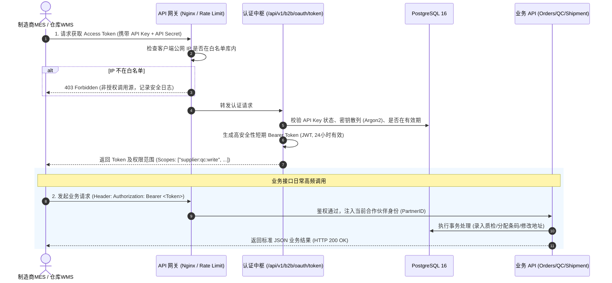

# 16 - 外部制造商与物流仓储标准 API 接口规范 (External B2B API Specification)

---

## 1. 业务目标与接口定位

在现代化分布式制造与跨国供应链体系中，代工制造厂（MES/产线工位）与海外仓储物流中心（德国海外仓 WMS / 3PL 物流系统）属于外部执行组织。  
本规范建立安全、高效、标准化的 **B2B RESTful API 体系**：
1. **统一认证与机器对机器（M2M）授权**：基于 API Key/Secret 与 OAuth2 Client Credentials 换发短期令牌，支持严格 IP 白名单与接口级权限切片。
2. **制造端核心赋能**：工单调取、序列号批量预发号、出厂终检（FQC）高精度数据回传（支持自定义检测项目、实测值、公差与单位）。
3. **仓储物流核心赋能**：扫码穿透调阅制造端质检金样数据、入库抽检（IQC）报告签发、临出库修改收货人地址/联系方式、出库确权。

---

## 2. API 安全接入与令牌管理流程 (M2M Token Lifecycle)



### 2.1 鉴权凭证数据模型 (`partner_api_credentials`)
```sql
CREATE TABLE partner_api_credentials (
    id UUID PRIMARY KEY DEFAULT gen_random_uuid(),
    partner_id VARCHAR(32) NOT NULL REFERENCES partners(partner_id) ON DELETE CASCADE,
    client_id VARCHAR(64) NOT NULL UNIQUE,       -- 外部对接专属 API Key (如: "bravio_live_supp_0013")
    client_secret_hash VARCHAR(255) NOT NULL,    -- 密钥 Argon2 散列存盘 (严禁明文)
    allowed_ip_whitelist VARCHAR(45)[] DEFAULT '{}', -- 允许请求的服务器外网 IP/CIDR 列表
    assigned_scopes VARCHAR(50)[] NOT NULL,      -- 权限切片，如: ['supplier:orders:read', 'supplier:qc:write', 'wms:qc:read']
    is_active BOOLEAN DEFAULT TRUE,
    expires_at TIMESTAMPTZ,                      -- 凭证过期日 (默认1年，定期轮换)
    last_used_at TIMESTAMPTZ,
    created_at TIMESTAMPTZ DEFAULT CURRENT_TIMESTAMP
);
```

---

## 3. 生产制造商 API 体系 (Supplier Manufacturing API)

### 3.1 调取生产工单列表 (Get Production Orders)
- **请求方式**：`GET /api/v1/b2b/supplier/orders`
- **功能描述**：代工厂 MES 自动拉取 OEM（Bravio）下达给该工厂的待生产/生产中工单、零件号、数量、图纸版次与物料 BOM 规格。
- **响应示例 (JSON)**：
```json
{
  "code": 200,
  "message": "success",
  "data": [
    {
      "order_no": "PO-2026-1008",
      "bravio_hw_pn": "99824",
      "product_name": "LED Matrix Headlight Gen 2",
      "hw_revision": "A",
      "ebom_code": "0013",
      "hw_version": "02",
      "target_qty": 2000,
      "produced_qty": 640,
      "allowed_led_bins": ["B3W3G", "B2W2F"],
      "bom_version_tag": "V1.1",
      "packaging_spec": {
        "pcs_per_box": 2,
        "boxes_per_carton": 20,
        "cartons_per_pallet": 24
      },
      "created_at": "2026-10-15T08:00:00Z"
    }
  ]
}
```

### 3.2 批量预分配单品序列号与批次流水号 (Batch Allocate Serial Numbers)
- **请求方式**：`POST /api/v1/b2b/supplier/batches/allocate-sn`
- **功能描述**：代工厂在安排打标雕刻前，向 Bravio 请求分配下一批合法的 32 位激光码流水号，避免流水号重复或错乱。
- **请求 Payload (JSON)**：
```json
{
  "order_no": "PO-2026-1008",
  "prod_yyww": "2550",
  "request_qty": 100
}
```
- **响应示例 (JSON)**：
```json
{
  "code": 200,
  "data": {
    "order_no": "PO-2026-1008",
    "batch_yyww": "2550",
    "allocated_count": 100,
    "start_rolling_no": "01201",
    "end_rolling_no": "01300",
    "sn_template_expression": "{BRAVIO_ID}{REV}{EBOM}{YYWW}{SEQ:5}{HW_VER}{LED_PN}{LED_FULL_BIN}"
  }
}
```

### 3.3 回传终检后每个零件的检测结果 (Upload Final QC Results)
- **请求方式**：`POST /api/v1/b2b/supplier/qc/upload-fqc`
- **功能描述**：制造端产线终检机或人工测试台完成检测后，批量上传每个单品 SN 的自定义检测项目、实测数值、单位与公差范围。**数据直通质量模块，绝无冗余重复建模。**
- **请求 Payload (JSON)**：
```json
{
  "order_no": "PO-2026-1008",
  "inspection_batch_yyww": "2550",
  "inspector_id": "SUPP_QC_TECH_04",
  "items_test_data": [
    {
      "sn_code": "99824A001325500120802SZ8Y19B3W3G",
      "overall_result": "PASS",
      "measurements": [
        {
          "item_name": "Luminous Flux (光通量)",
          "measured_value": 1850.4,
          "unit": "lm",
          "tolerance_min": 1700.0,
          "tolerance_max": 2000.0,
          "is_passed": true
        },
        {
          "item_name": "Color Temperature (色温)",
          "measured_value": 6025.0,
          "unit": "K",
          "tolerance_min": 5800.0,
          "tolerance_max": 6200.0,
          "is_passed": true
        },
        {
          "item_name": "Forward Voltage (正向电压)",
          "measured_value": 9.24,
          "unit": "V",
          "tolerance_min": 9.0,
          "tolerance_max": 9.6,
          "is_passed": true
        },
        {
          "item_name": "Thermal Dissipation Sink Temp (散热温升)",
          "measured_value": 58.2,
          "unit": "degC",
          "tolerance_min": 0.0,
          "tolerance_max": 75.0,
          "is_passed": true
        }
      ]
    }
  ],
  "report_summary": {
    "total_tested": 1,
    "pass_count": 1,
    "fail_count": 0
  }
}
```

### 3.4 产线制造损耗与单品作废销号 (Scrap Invalidation API)
- **请求方式**：`POST /api/v1/b2b/supplier/items/scrap`
- **功能描述**：代工厂在 SMT 贴片焊接、回流焊过炉或终检耐压测试中，对于已激光雕刻但出现电气击穿或物理破损的单品，必须调用此接口核销，杜绝作废条码被挪用。
- **请求 Payload (JSON)**：
```json
{
  "order_no": "PO-2026-1008",
  "scrap_records": [
    {
      "sn_code": "99824A001325500120802SZ8Y19B3W3G",
      "scrap_reason_category": "TEST_HIPOT_FAIL",
      "scrap_description": "耐压测试 1500V 击穿，PCB 驱动板短路烧毁",
      "inspector_id": "SUPP_QC_TECH_04"
    }
  ]
}
```
- **系统动作**：单品状态变更为 `SCRAPPED_AT_SUPPLIER`，并在工单 `scrapped_qty` 累加计数，永久封死后续配对封盒权限。

---

## 4. 仓库与物流 API 体系 (Warehouse & Logistics API)


### 4.1 调取生产终检结果对比抽验 (Query Factory QC for IQC)
- **请求方式**：`GET /api/v1/b2b/wms/items/{sn_or_pack_id}/factory-qc`
- **功能描述**：德国海外仓质检人员使用 PDA 扫描托盘、外箱或单品 SN 码，系统毫秒级穿透调取代工厂出厂时的原始实测光电数据与原始曲线，质检员复测后比对衰减率。
- **响应示例 (JSON)**：
```json
{
  "code": 200,
  "data": {
    "sn_code": "99824A001325500120802SZ8Y19B3W3G",
    "bravio_id": "99824",
    "factory_batch": "2550",
    "factory_tested_at": "2026-10-16T14:20:00Z",
    "factory_measurements": [
      { "item": "Luminous Flux", "factory_val": 1850.4, "unit": "lm" },
      { "item": "Color Temperature", "factory_val": 6025.0, "unit": "K" }
    ],
    "twin_sn_code": "99824A001325500120902SZ8Y19B3W3G",
    "box_id": "BOX-20261017-000128"
  }
}
```

### 4.2 提交仓库 IQC 抽检报告 (Submit Warehouse IQC)
- **请求方式**：`POST /api/v1/b2b/wms/qc/submit-iqc`
- **功能描述**：德国仓完成抽检复核后提交入库合格证明，系统自动将该包装单元及其子单品由 `LOCKED_PENDING_IQC` 批量解锁为 `AVAILABLE_IN_DE`（良品可售）。

### 4.3 临出库更新客户送货地址与联系方式 (Update Shipping Details)
- **请求方式**：`PATCH /api/v1/b2b/wms/outbound/{outbound_order_no}/shipping-address`
- **功能描述**：在仓库物理分拣打包或打托发出前，若分销商临时变更收货门店、变更联系电话或更新报关唛头，仓库 API 可直接校正送货信息，无需退单重下。
- **请求 Payload (JSON)**：
```json
{
  "contact_name": "Markus Weber",
  "phone": "+49 89 12345678",
  "street_address": "Industriestraße 45, Tor 3",
  "postal_code": "80331",
  "city": "München",
  "country_code": "DE",
  "delivery_notes": "大货车请从 3 号卸货门入内，需带升降尾板"
}
```

### 4.4 确认发货出库与资产确权 (Confirm Dispatch)
- **请求方式**：`POST /api/v1/b2b/wms/outbound/confirm-dispatch`
- **功能描述**：扫码枪扫描出库托盘/箱码，录入物流承运商单号（如 DHL Freight / Dachser），单品状态更新为 `SOLD_B2B`，资产所有权正式移交至分销商合作伙伴（`current_owner_id`）。
